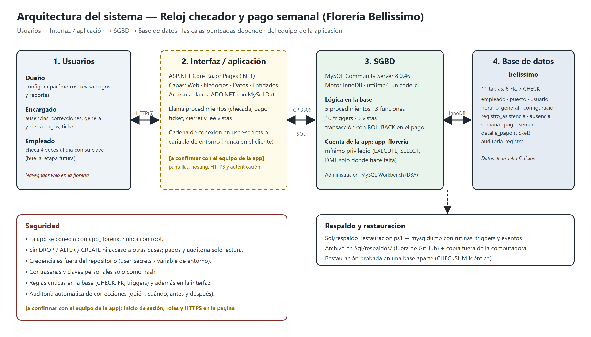

# 3. Arquitectura del sistema y tecnologías

## 3.1 Esquema de arquitectura

Archivo editable: `Diagramas/arquitectura.svg` (se abre en Inkscape, diagrams.net o cualquier
editor de texto). Las cajas punteadas dependen del equipo de la aplicación.

Flujo: el **usuario** usa la **interfaz web**; la aplicación se conecta al **SGBD** (MySQL) con
una cuenta de mínimo privilegio y ejecuta procedimientos y consultas; el SGBD guarda y protege los
datos en la **base de datos** `belissimo`. Las reglas críticas viven en el SGBD, así que se
cumplen sin importar qué pantalla haga la operación.

## 3.2 Tecnologías

| Capa | Tecnología | Estado |
| ---- | ---------- | ------ |
| Usuarios | Navegador web en la computadora de la florería | Listo |
| Interfaz / aplicación | ASP.NET Core Razor Pages (.NET), en capas Web, Negocios, Datos y Entidades (estructura actual del repositorio); acceso a datos con ADO.NET y el conector MySql.Data | Listo |
| SGBD | MySQL Community Server 8.0.46, motor InnoDB, `utf8mb4` / `utf8mb4_unicode_ci` | Implementado y probado |
| Base de datos | `belissimo`: 11 tablas, 3 vistas, 3 funciones, 5 procedimientos, 16 triggers | Implementado y probado |
| Herramientas | MySQL Workbench 8.0 (administración y diagramas), cliente `mysql`, `mysqldump`, Git y GitHub | En uso |

## 3.3 Mecanismos de acceso

- La aplicación se conecta por **TCP al puerto 3306** del servidor MySQL (en la misma computadora:
  `localhost`) con la cuenta **`app_floreria`** (`Sql/05_usuario_app.sql`).
- Usa **procedimientos almacenados** para las operaciones de negocio (`sp_registrar_checada`,
  `sp_generar_pago`, `sp_ticket`, `sp_cerrar_pago`, `sp_agregar_observacion`), **vistas** para los
  reportes y `INSERT`/`UPDATE`/`DELETE` con parámetros solo en las tablas del CRUD. La referencia
  completa está en `Sql/CONTRATO_BD.md`, cuyos ejemplos en C# se ejecutaron contra la base.
- La cadena de conexión se guarda en **user-secrets** (desarrollo) o en una **variable de entorno**
  (equipo de la florería), nunca en el código ni en el navegador (`Sql/conexion_plantilla.md`).
- El DBA administra la base con una cuenta administrativa desde MySQL Workbench.

## 3.4 Respaldo

- `Sql/respaldo_restauracion.ps1` genera respaldos con `mysqldump --single-transaction --routines
  --triggers --events`; así incluye datos, procedimientos, funciones, triggers y vistas.
- Los respaldos se guardan en `Sql/respaldos/`, que no se sube a GitHub porque puede contener
  datos personales. Se recomienda una copia fuera de la computadora.
- La restauración se **probó** en una base aparte: las 11 tablas dieron el mismo `CHECKSUM`
  (secciones 10.7 y 11).

## 3.5 Seguridad

- **Mínimo privilegio:** `app_floreria` no puede usar `DROP`, `ALTER` ni `CREATE`, no tiene
  acceso a otras bases y solo lee pagos y auditoría (17/17 casos de permisos verificados).
- **Credenciales fuera del repositorio** y contraseñas y claves personales guardadas solo como hash.
- **Integridad en el SGBD:** restricciones, triggers y procedimientos impiden datos inválidos,
  aunque la interfaz falle (sección 10.2).
- **Auditoría:** toda corrección de una checada guarda el antes, el después, el usuario de la
  página y la cuenta de MySQL.