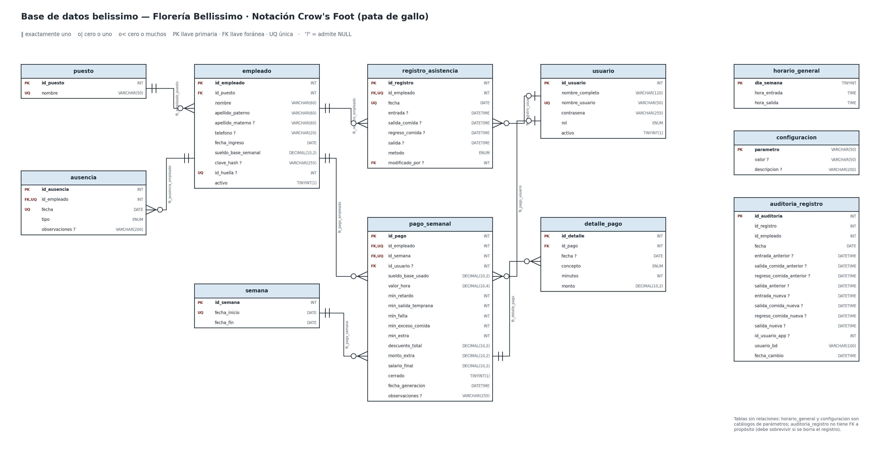
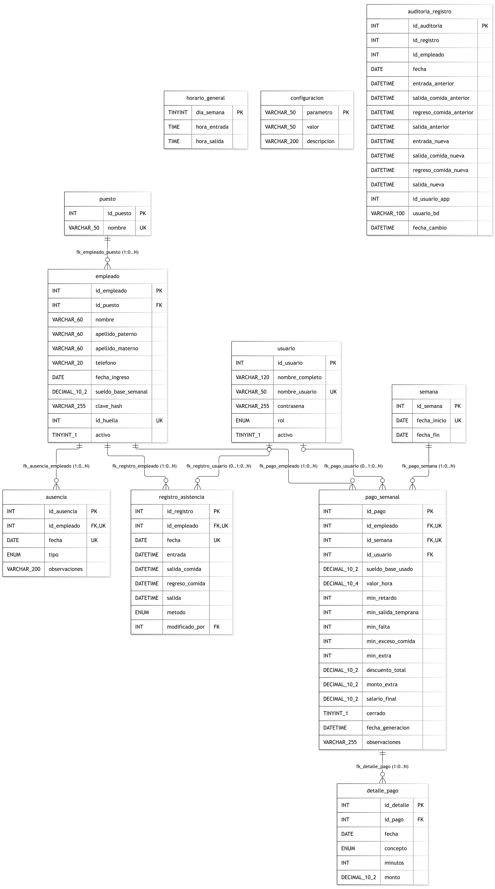
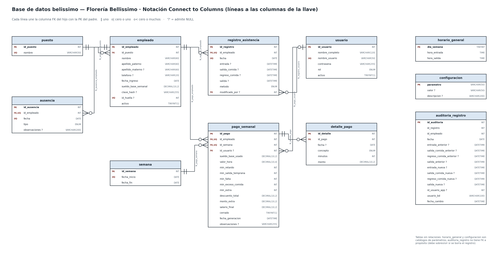
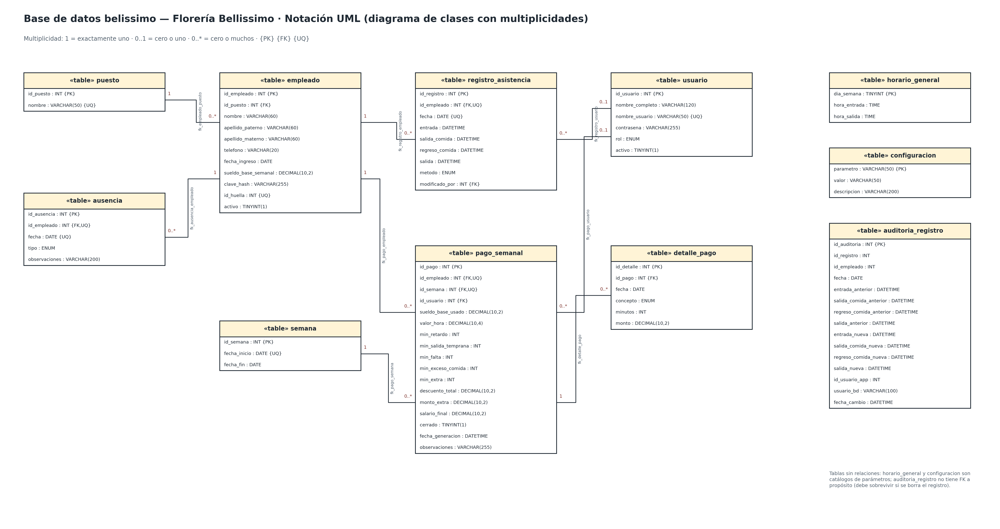
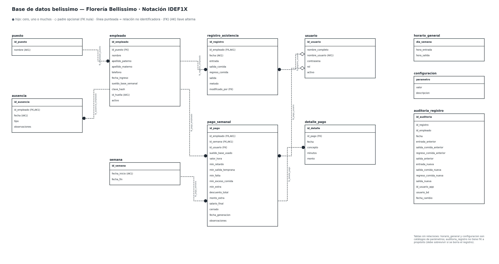

# 5. Diagramas y modelo relacional

Los cinco diagramas muestran **el mismo modelo** (11 tablas, 8 llaves foráneas), tomado de la
base real en MySQL 8.0.46. La explicación de cada notación y de cuál conviene está en
`Diagramas/README.md`. En resumen: se recomienda **Crow's Foot**, porque muestra en un solo
símbolo la cardinalidad y la participación (obligatoria u opcional).

## 5.1 Crow's Foot

## 5.2 Classic

## 5.3 Connect to Columns

## 5.4 UML

## 5.5 IDEF1X

## 5.6 Modelo relacional

Notación: **subrayado** = llave primaria · *cursiva* = llave foránea (→ tabla referenciada) ·
`UQ` = llave única.

- **puesto**(<u>id_puesto</u>, nombre `UQ`)
- **empleado**(<u>id_empleado</u>, *id_puesto* → puesto, nombre, apellido_paterno,
  apellido_materno, telefono, fecha_ingreso, sueldo_base_semanal, clave_hash, id_huella `UQ`,
  activo)
- **usuario**(<u>id_usuario</u>, nombre_completo, nombre_usuario `UQ`, contrasena, rol, activo)
- **horario_general**(<u>dia_semana</u>, hora_entrada, hora_salida)
- **configuracion**(<u>parametro</u>, valor, descripcion)
- **registro_asistencia**(<u>id_registro</u>, *id_empleado* → empleado, fecha, entrada,
  salida_comida, regreso_comida, salida, metodo, *modificado_por* → usuario)
  · `UQ(id_empleado, fecha)`
- **ausencia**(<u>id_ausencia</u>, *id_empleado* → empleado, fecha, tipo, observaciones)
  · `UQ(id_empleado, fecha)`
- **semana**(<u>id_semana</u>, fecha_inicio `UQ`, fecha_fin)
- **pago_semanal**(<u>id_pago</u>, *id_empleado* → empleado, *id_semana* → semana,
  *id_usuario* → usuario, sueldo_base_usado, valor_hora, min_retardo, min_salida_temprana,
  min_falta, min_exceso_comida, min_extra, descuento_total, monto_extra, salario_final, cerrado,
  fecha_generacion, observaciones) · `UQ(id_empleado, id_semana)`
- **detalle_pago**(<u>id_detalle</u>, *id_pago* → pago_semanal, fecha, concepto, minutos, monto)
- **auditoria_registro**(<u>id_auditoria</u>, id_registro, id_empleado, fecha,
  entrada_anterior, salida_comida_anterior, regreso_comida_anterior, salida_anterior,
  entrada_nueva, salida_comida_nueva, regreso_comida_nueva, salida_nueva, id_usuario_app,
  usuario_bd, fecha_cambio) — sin FK, a propósito

Todas las FK: `ON UPDATE CASCADE`, `ON DELETE RESTRICT`. Tipos, longitudes, nulos y valores por
omisión de cada columna: sección 6, diccionario de datos.
