# 13. Aplicación web

La aplicación web **Bellissimo** fue desarrollada en **ASP.NET Core Razor Pages (.NET 10)** con **C#** y **Bootstrap** como interfaz gráfica operativa para la administración de recursos humanos, registro de asistencia mediante checador por clave personal, gestión de ausencias, corrección de checadas y cálculo de nómina semanal de la florería.

---

## 13.1 Arquitectura de la aplicación

La solución implementa una arquitectura en **cuatro capas** con flujo unidireccional de dependencias (`Web → Negocios → Datos → MySQL`), separando las responsabilidades de presentación, reglas de negocio, acceso a datos y modelos de dominio:

| Proyecto / Capa | Responsabilidad técnica |
| --- | --- |
| `Bellissimo.Web` | Capa de presentación desarrollada con **Razor Pages** (`.cshtml` y PageModels `.cshtml.cs`) y **Bootstrap**. Gestiona el enrutamiento, el enlace de modelos (*Model Binding*), validaciones de entrada en cliente/servidor y la retroalimentación visual al usuario. |
| `Bellissimo.Negocios` | Capa de lógica de negocio (`PersonalNegocio`, `PuestoNegocio`, `ChecadorNegocio`, `AsistenciaNegocio`, `AusenciaNegocio`, `PagoNegocio`, `SemanaNegocio`, `UsuarioNegocio`). Aplica reglas de negocio, valida precondiciones antes de persistir y traduce excepciones técnicas mediante `ErroresBaseDatos` y `ReglaNegocioException`. |
| `Bellissimo.Datos` | Capa de acceso a datos (`Conexion`, `PersonalDatos`, `PuestoDatos`, `ChecadorDatos`, `RegistroAsistenciaDatos`, `AusenciaDatos`, `PagoDatos`, `SemanaDatos`, `UsuarioDatos`). Ejecuta consultas SQL parametrizadas y llamadas a procedimientos almacenados mediante **ADO.NET (`MySql.Data`)**, atrapando errores de integridad en `BaseDatosException`. |
| `Bellissimo.Entidades` | Biblioteca de clases con los objetos de transferencia y modelos del dominio compartidos entre capas (`Personal`, `Puesto`, `Checada`, `RegistroAsistencia`, `Ausencia`, `Pago`, `Ticket`, `Usuario`). |

---

## 13.2 Conexión y seguridad con MySQL

Para proteger las credenciales de acceso y cumplir con el principio de menor privilegio:

1. **Usuario dedicado del SGBD:** La aplicación nunca utiliza `root`. Se conecta exclusivamente mediante el usuario `app_floreria` (creado en `Sql/05_usuario_app.sql`), el cual cuenta únicamente con permisos de ejecución (`EXECUTE`) sobre rutinas almacenadas y operaciones DML (`SELECT`, `INSERT`, `UPDATE`, `DELETE`) sobre las tablas operativas de la base de datos `belissimo`, sin privilegios administrativos ni de alteración de esquema (`DDL`).
2. **Gestión de credenciales fuera del código fuente:** La cadena de conexión (`ConnectionStrings:Bellissimo`) no se almacena en `appsettings.json` ni en el repositorio de Git. En su lugar, se configura localmente mediante **User Secrets** de .NET (`dotnet user-secrets set`), siguiendo la plantilla documentada en `Sql/conexion_plantilla.md`:

```json
{
  "ConnectionStrings": {
    "Bellissimo": "Server=localhost;Port=3306;Database=belissimo;User ID=app_floreria;Password=<contraseña>;CharSet=utf8mb4;SslMode=Preferred"
  }
}
```

3. **Consultas parametrizadas:** Toda comunicación desde `Bellissimo.Datos` utiliza parámetros tipados (`MySqlParameter`) o procedimientos almacenados, mitigando ataques de inyección SQL.

---

## 13.3 Módulos y capturas de la aplicación funcionando

### 13.3.1 Navegación general e inicio
La pantalla principal (`Pages/Index.cshtml`) centraliza el acceso mediante una barra de navegación superior hacia los módulos operativos: **Inicio**, **Entradas**, **Salidas**, **Asistencias**, **Ausencias**, **Pagos**, **Personal** y **Puestos**.

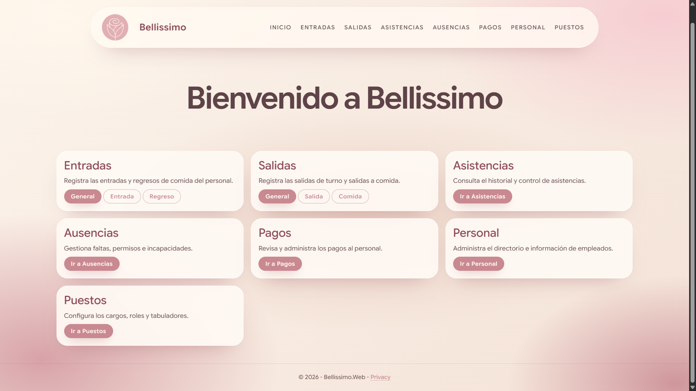

### 13.3.2 Catálogo de Puestos (CRUD — Entidad 1)
El módulo `Pages/Puestos/` permite consultar los puestos laborales vigentes, registrar nuevos cargos con su sueldo base y tarifa por hora, así como editar sus montos.

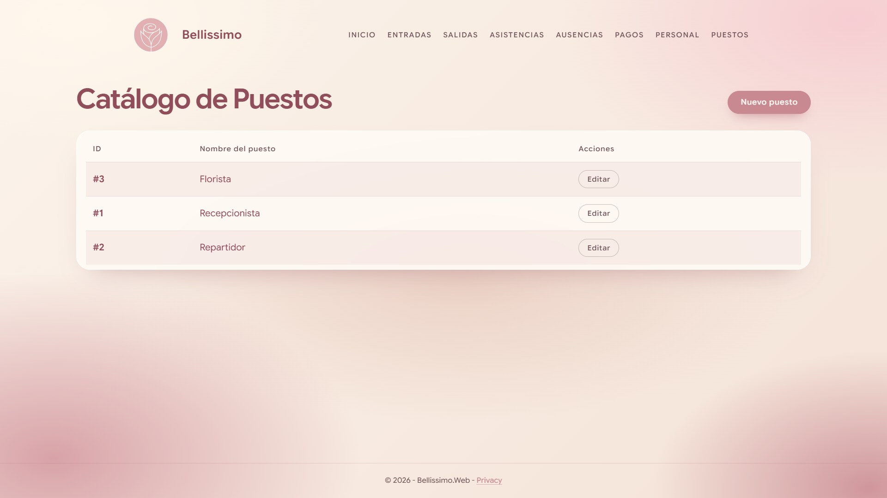

### 13.3.3 Gestión de Personal (CRUD y búsqueda — Entidad 2)
El módulo `Pages/Personal/` implementa el ciclo completo de administración de empleados: listado general con filtro de búsqueda por nombre o clave, consulta de detalle, alta de nuevos trabajadores asociados a una llave foránea de `Puesto` y edición con baja lógica.

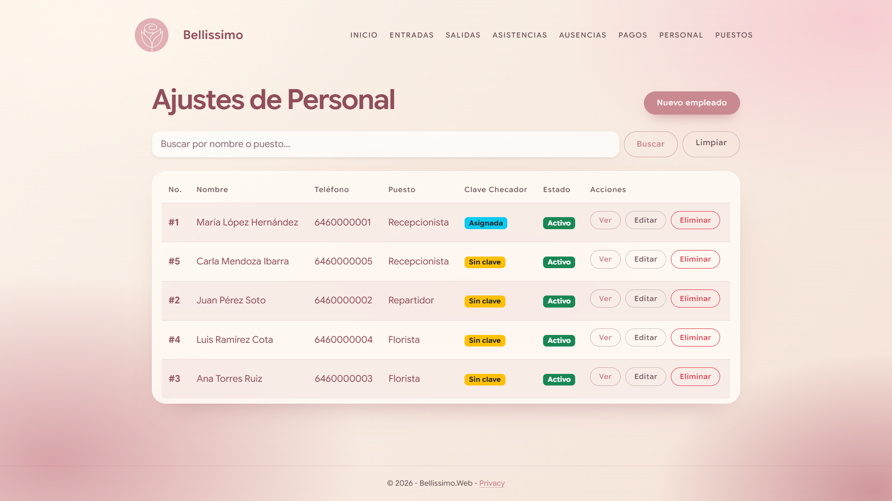

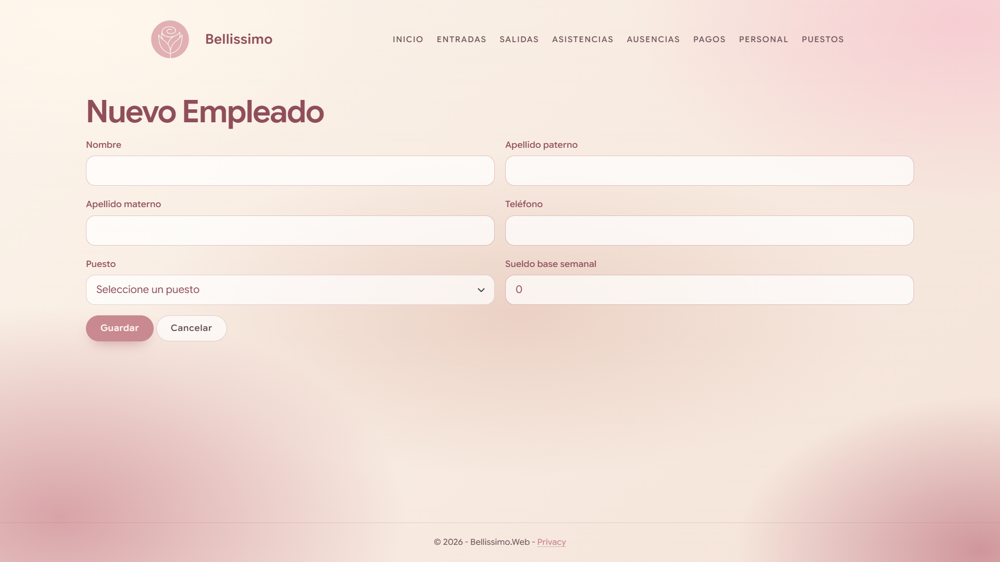

### 13.3.4 Gestión de Ausencias (CRUD — Entidad 3)
En `Pages/Ausencias/` se registran, editan y eliminan las faltas o permisos asociados a un empleado (`Personal`), indicando fecha, tipo de ausencia y justificación para su consideración en el cálculo semanal.

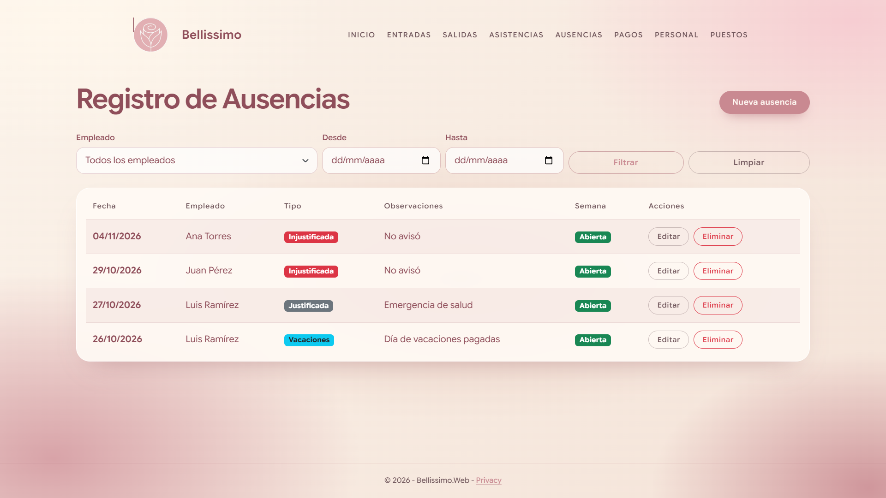

### 13.3.5 Checador de Entradas y Salidas con clave personal
Los módulos `Pages/RegistroEntradas/` y `Pages/RegistroSalidas/` operan como terminal de checado rápido mediante la clave personal del trabajador, registrando entrada laboral, salida a comer, regreso de comida y salida final del turno.

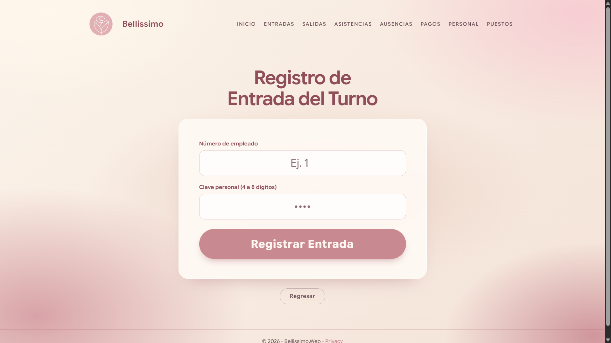

### 13.3.6 Generación de Semanas, Nómina y Ticket de Pago (Operación multitabla)
El módulo `Pages/Pagos/` ejecuta la operación de negocio principal del sistema: a partir de una semana laboral (`Semana`), consolida información de múltiples tablas (`Personal`, `Puesto`, `RegistroAsistencia` y `Ausencia`), aplica reglas de cálculo y genera los registros en `Pago` junto con su desglose individual en `Pages/Pagos/Ticket.cshtml`.

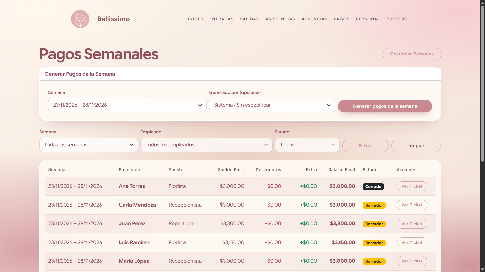

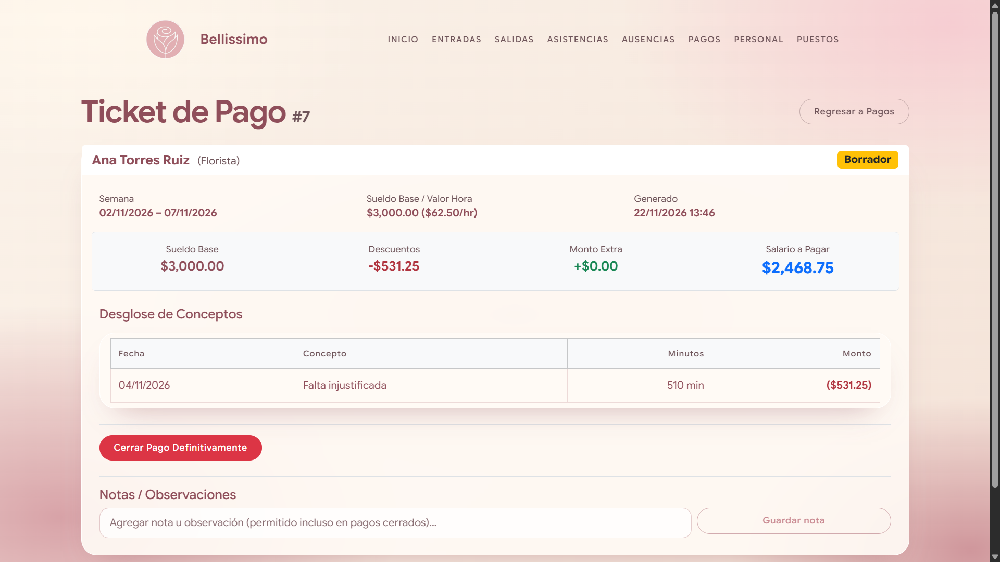

### 13.3.7 Reporte de Asistencias, correcciones y manejo de estados vacíos
El módulo `Pages/Asistencias/` permite realizar correcciones manuales autorizadas sobre registros de asistencia y consultar el reporte consolidado cruzando empleado, puesto, horarios y observaciones (`Pages/Asistencias/Reporte.cshtml`), así como visualizar días sin checada. Cuando un filtro no arroja coincidencias, la interfaz presenta un estado vacío controlado sin errores.

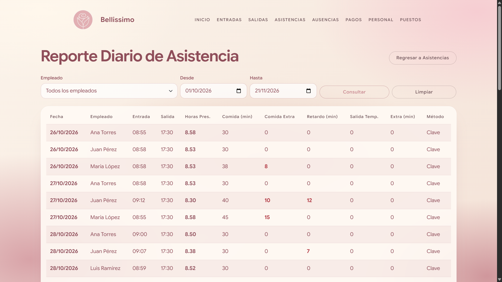

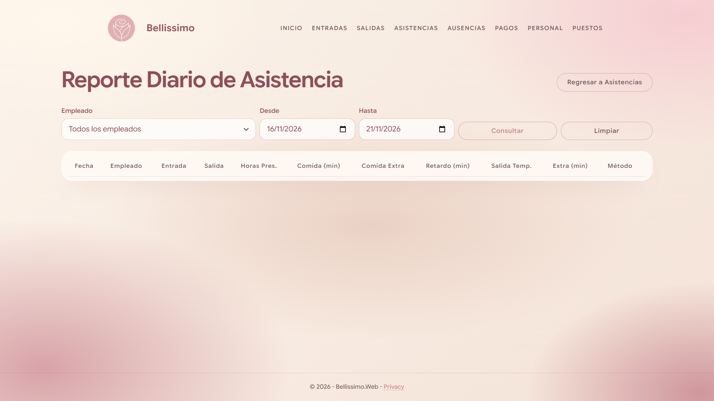

---

## 13.4 Validaciones, control de errores y evidencia de persistencia

### 13.4.1 Validación de campos y reglas de negocio
La aplicación valida datos tanto en el formulario (campos requeridos, tipos numéricos, rangos de fecha y formatos) como en la capa de negocio y el SGBD (claves inexistentes, registros duplicados o restricciones de integridad referencial), mostrando mensajes claros al usuario sin exponer trazas técnicas.

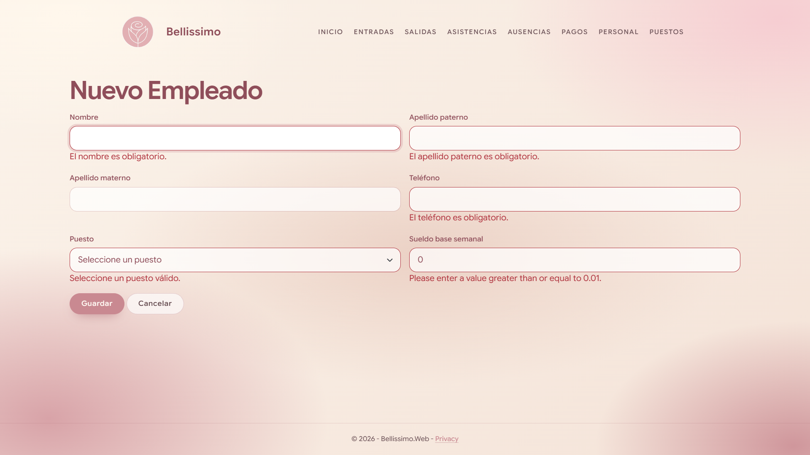

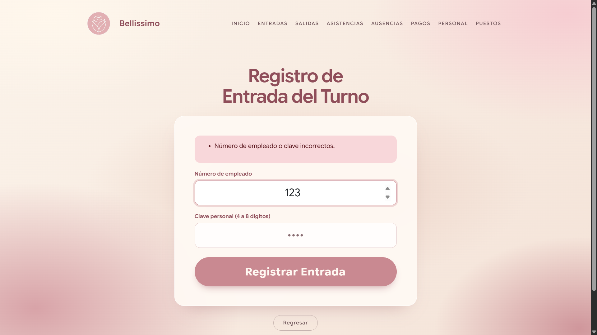

### 13.4.2 Acreditación de persistencia real en MySQL
Para comprobar que toda operación impacta directamente en el SGBD relacional sin almacenamiento simulado en memoria:
1. Se realizó un registro desde la interfaz web y se verificó su almacenamiento físico ejecutando una consulta `SELECT` directamente en **MySQL Workbench**.
2. Se detuvo por completo el servidor local de la aplicación (`Bellissimo.Web`), se cerró el navegador y se volvió a iniciar la ejecución (`dotnet run`), confirmando que los registros persisten y se recuperan íntegramente desde MySQL.

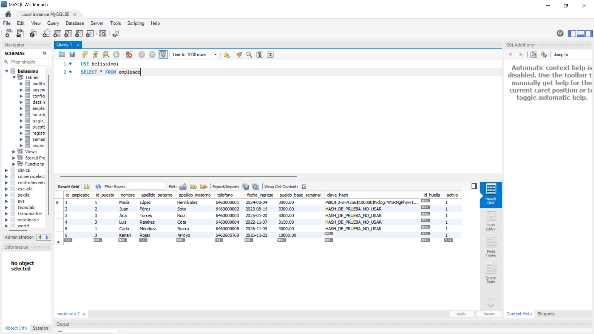

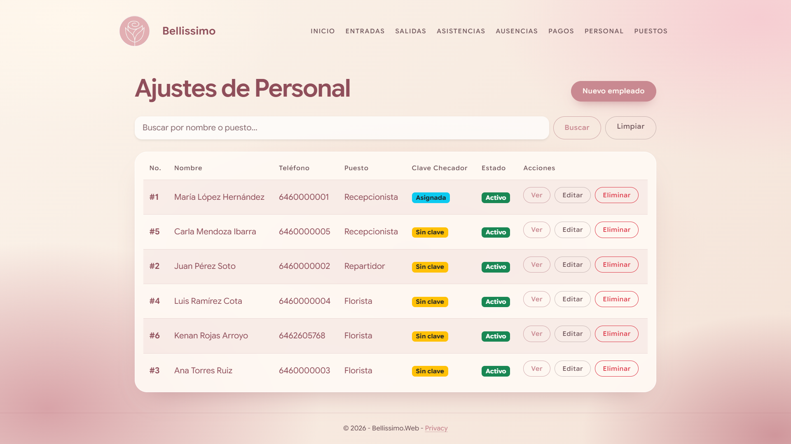

---

## 13.5 Pruebas de interfaz (A01–A08)

A continuación se documentan los resultados observados al ejecutar los casos de prueba funcionales de interfaz definidos en la matriz de pruebas (Sección 11):

| ID | Caso de prueba | Módulo / Ruta | Datos / Acción ejecutada | Resultado observado | Estado |
| --- | --- | --- | --- | --- | :---: |
| **A01** | Alta de empleado con puesto válido | `/Personal/Nuevo` | Captura de datos completos de empleado nuevo vinculado a un `id_puesto` existente y envío de formulario. | Se inserta el registro en la tabla `personal`, muestra mensaje de confirmación y aparece en el listado general. | **Aprobado** |
| **A02** | Validación de campos obligatorios y formato | `/Personal/Nuevo` y `/Puestos/Nuevo` | Envío de formulario con campos vacíos o valores numéricos fuera de rango. | La interfaz bloquea el envío y despliega alertas de validación junto a cada campo inválido sin fallar. | **Aprobado** |
| **A03** | Búsqueda y filtro de empleados (con resultados y estado vacío) | `/Personal/Index` | Búsqueda por nombre existente y posterior búsqueda con cadena inexistente (`"ZZZZ"`). | Filtra correctamente las coincidencias en el primer caso y muestra mensaje controlado de estado vacío en el segundo. | **Aprobado** |
| **A04** | Edición y baja lógica de personal | `/Personal/Editar` | Modificación de datos del empleado y cambio de estatus activo a inactivo. | Actualiza el registro en MySQL preservando su historial de asistencias y pagos sin romper integridad referencial. | **Aprobado** |
| **A05** | Registro de checada con clave personal válida e inválida | `/RegistroEntradas/RegistroEntrada` | Ingreso de clave personal registrada y posterior prueba con clave inexistente (`"999999"`). | Con clave válida registra la hora exacta en `registro_asistencia`; con clave inválida muestra error controlado de negocio. | **Aprobado** |
| **A06** | Registro y consulta de ausencia (CRUD) | `/Ausencias/Nuevo` | Alta de ausencia asociada a empleado y fecha específica. | Persiste en `ausencia`, se visualiza en el listado y se refleja en el cálculo de descuentos de la semana correspondiente. | **Aprobado** |
| **A07** | Generación de semana, cálculo de pago y ticket | `/Pagos/Index` y `/Pagos/Ticket` | Generación de nómina semanal, consulta de ticket individual y agregado de nota/observación. | Consolida sueldos, descuentos y extras en `pago`, despliega el ticket con su desglose y guarda las observaciones. | **Aprobado** |
| **A08** | Reporte de asistencia multitabla y persistencia tras reinicio | `/Asistencias/Reporte` | Consulta filtrada por fechas/empleado, cierre del servidor web, reapertura y consulta en MySQL Workbench. | Muestra datos cruzados de personal, puesto y checadas; tras reiniciar la app y consultar el SGBD, todos los datos permanecen intactos. | **Aprobado** |

---

## 13.6 Cumplimiento del contrato de BD y validaciones de interfaz

La implementación de la capa web y de negocios respeta estrictamente las reglas establecidas en `Sql/CONTRATO_BD.md` y `Sql/validaciones_interfaz.md`:

* **Regla 0 del contrato (`CONTRATO_BD.md`):** Ninguna regla crítica de integridad reside únicamente en el cliente. Las restricciones de llaves primarias, llaves foráneas, unicidad (`UNIQUE`), obligatoriedad (`NOT NULL`), dominios (`CHECK`) y lógica transaccional se hacen cumplir en el motor **MySQL 8.0** (mediante restricciones de esquema, procedimientos almacenados y triggers), mientras que `Bellissimo.Negocios` y `Bellissimo.Web` replican las validaciones preventivas para mejorar la experiencia de usuario.
* **No duplicidad de efectos con triggers:** En operaciones donde un trigger del SGBD actualiza automáticamente campos derivados o de auditoría (como cálculos asociados a registros de asistencia o cierres), la capa `Bellissimo.Datos` delega dicha actualización al motor de base de datos sin ejecutar una segunda sentencia `UPDATE` redundante desde C#.
* **Manejo controlado de excepciones SQL:** Cuando MySQL rechaza una operación por violación de restricción (`SQLSTATE` de llave duplicada, referencia inexistente o regla de negocio lanzada con `SIGNAL SQLSTATE '45000'`), `BaseDatosException` y `ErroresBaseDatos` capturan el código de error y presentan un mensaje comprensible en pantalla.