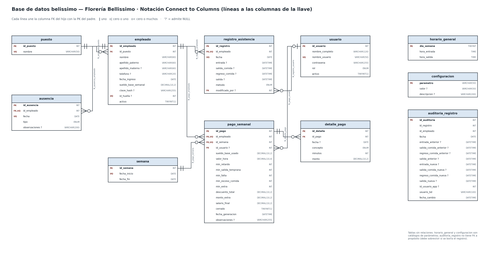
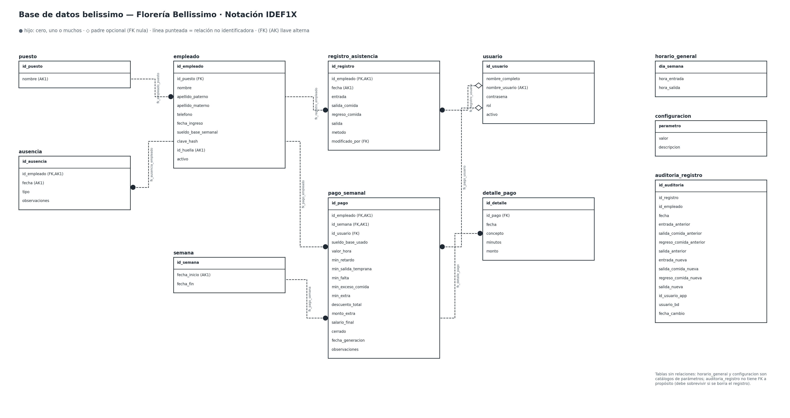

# Proyecto final — Base de datos

**Sistema de reloj checador y pago semanal — Florería Bellissimo**

Universidad Autónoma de Baja California · Facultad de Ingeniería, Arquitectura y Diseño (FIAD)
· Ingeniería en Software y Tecnologías Emergentes (ISyTE) · Materia: Base de datos

**Equipo:** [EQUIPO_XX]

| Integrante | Rol |
| ---------- | --- |
| [INTEGRANTE_1] | Administrador de base de datos (DBA) |
| [INTEGRANTE_2] | [ROL — backend] |
| [INTEGRANTE_3] | [ROL — frontend] |
| [INTEGRANTE_N] | [ROL] |

**Maestro:** [NOMBRE_DEL_MAESTRO] · **Fecha de entrega:** [FECHA] · **Plataforma:** [PLATAFORMA]

**Repositorio:** https://github.com/KenanRojasArroyo/Bellissimo

---

## Contenido

1. Planteamiento del problema
2. Reglas de negocio y requerimientos funcionales
3. Entidades, claves y relaciones
4. Diagramas y modelo relacional
5. Diccionario de datos
6. Anomalías y normalización
7. Álgebra relacional
8. Consultas SQL explicadas
9. Implementación en MySQL 8.0
10. Pruebas de base de datos
11. Incidencias
12. Aplicación web *[A cargo de frontend/backend]*
13. Conclusiones

<div class="salto"></div>

# 1. Planteamiento del problema

La Florería Bellissimo tiene 11 empleados (recepción, reparto y florería) con un horario único:
**lunes a viernes de 9:00 a 17:30 y sábado de 9:00 a 15:30**. Hoy la asistencia se anota a mano y
el pago semanal se calcula en papel. Esto provoca:

- **Errores de cálculo:** retardos, comida de más, salidas antes de tiempo, faltas y horas extra
  se suman a mano cada semana.
- **Pagos difíciles de justificar:** cuando un empleado pregunta por qué cobró menos, no hay un
  ticket con el detalle día por día.
- **Cambios sin rastro:** si alguien corrige una hora anotada, no queda registro de quién lo hizo
  ni del valor anterior.
- **Información repetida y contradictoria:** el sueldo, el puesto y el horario se copian en cada
  hoja semanal (ver anomalías en la sección de normalización).

**Objetivo de la base de datos.** Guardar las **cuatro checadas diarias** de cada empleado
(entrada, salida a comer, regreso y salida) y las ausencias, **calcular el pago semanal** con
descuentos y tiempo extra según las reglas acordadas con el dueño, **congelar** el pago ya
entregado con un ticket que lo justifique, y **auditar** toda corrección. La base la usan el
dueño y el encargado desde una página web (ASP.NET Core Razor Pages, a cargo del equipo de la
aplicación).

**Alcance.** Incluye empleados, puestos, usuarios de la página, horario, parámetros de cálculo,
checadas, ausencias, semanas, pagos, ticket y auditoría. **Fuera de alcance (etapa 2):**
bonificaciones y vacaciones por antigüedad. El checado por huella queda preparado
(`empleado.id_huella`, método `Huella`), pero todavía no se usa.

**Datos.** Todos los datos de prueba son **ficticios** (5 empleados, 2 semanas). No se usan
datos reales de los empleados.

<div class="salto"></div>

# 2. Reglas de negocio y requerimientos funcionales

Reglas acordadas con el dueño de la florería. Cada una dice **qué mecanismo de la base la hace
cumplir** y **con qué prueba se verifica** (`Pruebas/pruebas_bd.sql`; resultados en
`Pruebas/matriz_pruebas.md`). Las marcadas *Supuesto* o *Pendiente* no las cerró el DBA.

## 2.1 Reglas de negocio (verificables)

| ID | Regla | Mecanismo en la BD | Verificación |
| -- | ----- | ------------------ | ------------ |
| RN01 | Horario único: lunes a viernes 9:00–17:30, sábado 9:00–15:30; domingo no se trabaja. | Datos de `horario_general`; `ck_horario_dia` (1–6), `ck_horario_horas` (salida > entrada); `sp_registrar_checada` rechaza domingos. | P07; consulta a `horario_general` |
| RN02 | El sueldo base semanal se captura al dar de alta y debe ser mayor a 0. | `empleado.sueldo_base_semanal NOT NULL` + `ck_empleado_sueldo`. | P01, P04 |
| RN03 | Valor de la hora = sueldo base ÷ 48. | `fn_valor_hora` + `configuracion.horas_semana_base = 48`. | P09 (`fn_valor_hora(3300) = 68.7500`) |
| RN04 | Un solo registro de asistencia por empleado y día, con máximo 4 checadas en orden (entrada, salida a comer, regreso, salida). | `uq_registro_dia`; `ck_registro_orden`; `ck_registro_fecha`; `sp_registrar_checada` decide la siguiente y rechaza una quinta o una hora anterior. | P07, P08, P15b, P15c, P15d |
| RN05 | Tolerancia de 5 min; pasando la tolerancia el retardo se mide desde la hora oficial. | `configuracion.tolerancia_min = 5`; `sp_generar_pago` (renglón `RETARDO`); `v_asistencia_diaria`. | P10, P13 |
| RN06 | Comida de 30 min pagada; el exceso se descuenta. | `configuracion.comida_min = 30`; `fn_minutos_comida_extra`; `sp_generar_pago` (`COMIDA_EXCESO`). | P09, regresión (María semana 1: 85 min → $2,911.45) |
| RN07 | La salida antes de la hora oficial se descuenta. | `sp_generar_pago` (`SALIDA_TEMPRANA`). | P10 (Juan: 34.38) |
| RN08 | Falta injustificada descuenta la jornada del día (510 min entre semana, 390 el sábado); justificada (solo salud) y vacaciones no se descuentan. *La justificada pagada es un **supuesto**.* | `ausencia.tipo ENUM('Justificada','Injustificada','Vacaciones')`; `uq_ausencia_dia`; `sp_generar_pago` (`FALTA_INJUSTIFICADA`). | P10 (Juan: 584.38); regresión (Luis semana 1 = $3,150.00 con vacaciones y falta justificada) |
| RN09 | Retardos acumulados en la semana: regla **pendiente**; mientras no se defina, no descuentan. | `configuracion.retardo_min_para_1h/2h = NULL`; `sp_generar_pago` solo descuenta si tienen valor. | Regresión (Juan semana 1 sin `RETARDO_ACUMULADO`) |
| RN10 | Tiempo extra: los primeros 540 min de la semana ×2 y el resto ×3. *Multiplicadores por **confirmar** con el contador.* | `configuracion.extra_umbral_min/mult_doble/mult_triple`; `sp_generar_pago` (`TIEMPO_EXTRA`, con función de ventana). | Regresión (Juan semana 2: 720 min → $1,856.25) |
| RN11 | Salario = sueldo − descuentos + extra, nunca menor a $0. | `GREATEST(0, …)` en `sp_generar_pago`; `ck_pago_montos`. | P10, regresión |
| RN12 | Un solo pago por empleado y semana. | `uq_pago_empleado_semana`; `sp_generar_pago` actualiza si ya existe. | P10 (regenerar no duplica) |
| RN13 | Un pago cerrado queda congelado: ni checadas, ni ausencias, ni ticket, ni montos de esa semana; solo observaciones. | `sp_cerrar_pago`; `fn_semana_cerrada`; triggers `trg_registro_bi/bu/bd_cerrado`, `trg_ausencia_bi/bu/bd_cerrado`, `trg_detalle_bi/bu/bd_cerrado`, `trg_pago_bu_cerrado`, `trg_pago_bd_cerrado`; `sp_generar_pago` rechaza regenerar. | P14, P14a–e, P17, P17a–b, P18, P18a–b |
| RN14 | Toda corrección manual de una checada queda registrada (antes, después, usuario de la app y usuario de BD). | `trg_registro_au_auditoria` → `auditoria_registro`. | P13 |
| RN15 | No se borra información con historial (empleados, puestos, semanas, pagos con ticket). | FK con `ON DELETE RESTRICT`; baja lógica con `activo = 0`. | P05, P06 |
| RN16 | Contraseñas y claves personales se guardan solo como hash. | Convención: `usuario.contrasena` y `empleado.clave_hash` `VARCHAR(255)`; **lo hace la app** (la BD no puede verificar que sea hash). | Revisión de la app (pendiente — equipo de la aplicación) |

Decisiones pendientes con el dueño (documentadas, no cerradas): regla de retardos acumulados
(RN09), si la falta justificada se paga (RN08), multiplicadores de tiempo extra (RN10), quién
corrige checadas olvidadas, y si se permite **checada y ausencia el mismo día** (hallazgo PEN-01
en `Pruebas/incidencias.md`).

## 2.2 Requerimientos funcionales

| ID | Requerimiento | Lo cumple | Verificación |
| -- | ------------- | --------- | ------------ |
| RF01 | Registrar las 4 checadas del día con fecha y hora exactas, por clave (y huella en el futuro). | `sp_registrar_checada` | P07, P08 |
| RF02 | Dar de alta, consultar, modificar y dar de baja empleados. | Tabla `empleado` + `ck_empleado_sueldo` + FK; baja con `activo = 0` | P01, P02, P03, P04, P05, P06 |
| RF03 | Registrar ausencias (justificada, injustificada, vacaciones). | Tabla `ausencia` + `uq_ausencia_dia` + `trg_ausencia_*` | P18 |
| RF04 | Corregir una checada a mano con rastro de quién y qué cambió. | `UPDATE registro_asistencia` (con `modificado_por`) + `trg_registro_au_auditoria` | P13 |
| RF05 | Calcular el pago semanal con descuentos y tiempo extra, sin dejar datos a medias si algo falla. | `sp_generar_pago` (`START TRANSACTION … COMMIT`, `ROLLBACK` en error) | P10 |
| RF06 | Mostrar el ticket que justifica el pago sin recalcular. | `sp_ticket` (2 resultados: resumen y detalle) | P10 |
| RF07 | Cerrar (congelar) un pago ya pagado. | `sp_cerrar_pago` + triggers de semana cerrada | P14, P17 |
| RF08 | Agregar observaciones a un pago, incluso cerrado. | `sp_agregar_observacion` | P14 |
| RF09 | Reporte de asistencia diaria por empleado. | `v_asistencia_diaria` | Consultas 6 y vista en `04_consultas_vistas.sql` |
| RF10 | Resumen de pagos de la semana con estado. | `v_resumen_pago_semanal` | P16 |
| RF11 | Avisar de días laborales sin checada ni ausencia antes de cerrar la semana. | `v_dias_sin_checada` | P19 |
| RF12 | Cambiar parámetros del cálculo sin modificar el sistema. | Tabla `configuracion` (leída por funciones y procedimientos) | Revisión de `sp_generar_pago` |
| RF13 | Consultar el historial de correcciones de checadas. | Tabla `auditoria_registro` | P13 |
| RF14 | Iniciar sesión con rol Dueño o Encargado. | Tabla `usuario` (`rol`, `activo`, hash); la validación del hash la hace la app | Pendiente — equipo de la aplicación |

<div class="salto"></div>

# 3. Entidades, claves y relaciones

Base `belissimo` (MySQL 8.0). Todo lo que se dice de restricciones y llaves se puede comprobar en
la sección 5 (diccionario de datos), que se generó desde `information_schema`.

## 3.1 Entidades

| Entidad (tabla) | Clasificación | Justificación (regla de negocio) |
| --------------- | ------------- | -------------------------------- |
| `puesto` | **Fuerte** | Existe por sí misma; es un catálogo (Recepcionista, Repartidor, Florista). |
| `empleado` | **Fuerte** | Se identifica por sí mismo (`id_empleado`). Depende de `puesto` solo por referencia: todo empleado tiene un puesto, pero su identidad no viene del puesto. |
| `usuario` | **Fuerte** | Dueño y encargado de la página; identidad propia (`id_usuario`, `nombre_usuario`). |
| `semana` | **Fuerte** | Periodo de pago lunes–sábado identificado por su fecha de inicio. |
| `horario_general` | **Fuerte** (catálogo) | Un renglón por día de la semana (1–6); el horario es único para todos. |
| `configuracion` | **Fuerte** (catálogo) | Parámetros que el dueño puede cambiar sin tocar el sistema. |
| `registro_asistencia` | **Débil** (por existencia y por identificación) | Una checada no tiene sentido sin el empleado. Su identificador natural es (`id_empleado`, `fecha`), que incluye la llave del dueño. Se implementa con PK sustituta `id_registro` más `UNIQUE (id_empleado, fecha)`. |
| `ausencia` | **Débil** | Igual que la checada: existe solo para un empleado, y su identificador natural es (`id_empleado`, `fecha`). |
| `pago_semanal` | **Asociativa** | Resuelve la relación muchos-a-muchos **empleado–semana** (un empleado cobra muchas semanas; en una semana cobran muchos empleados) y tiene atributos propios (montos, minutos, estado). Su llave natural es (`id_empleado`, `id_semana`). |
| `detalle_pago` | **Débil** (por existencia) | Un renglón del ticket solo existe dentro de un pago. No tiene llave natural declarada (ver §3.2). |
| `auditoria_registro` | **Fuerte** (bitácora) | A propósito **no** tiene FK: debe conservarse aunque el registro auditado se borre. |

> **Nota de implementación.** Todas las tablas débiles usan una PK sustituta `AUTO_INCREMENT`, y su
> llave natural queda como `UNIQUE`. Por eso en el modelo físico todas las relaciones son **no
> identificadoras**: la FK no forma parte de la PK. Así aparece en el diagrama IDEF1X, con líneas
> punteadas. Se eligió así porque la app y las FK trabajan con un solo entero, y porque la llave
> natural sigue protegida.

## 3.2 Claves candidatas

| Tabla | PK elegida | Otras claves candidatas | Cómo se garantiza |
| ----- | ---------- | ----------------------- | ----------------- |
| `puesto` | `id_puesto` | `nombre` | `UNIQUE` |
| `empleado` | `id_empleado` | `id_huella` *(solo cuando no es NULL)* | `UNIQUE` (MySQL permite varios NULL) |
| `usuario` | `id_usuario` | `nombre_usuario` | `UNIQUE` |
| `horario_general` | `dia_semana` | — | PK + `ck_horario_dia` (1–6) |
| `configuracion` | `parametro` | — | PK natural |
| `registro_asistencia` | `id_registro` | (`id_empleado`, `fecha`) | `uq_registro_dia` |
| `ausencia` | `id_ausencia` | (`id_empleado`, `fecha`) | `uq_ausencia_dia` |
| `semana` | `id_semana` | `fecha_inicio`; también `fecha_fin` (semánticamente) | `UNIQUE (fecha_inicio)`; `fecha_fin` no está declarada como única |
| `pago_semanal` | `id_pago` | (`id_empleado`, `id_semana`) | `uq_pago_empleado_semana` |
| `detalle_pago` | `id_detalle` | En la práctica (`id_pago`, `fecha`, `concepto`), porque el procedimiento genera un renglón por concepto y día, pero **no está declarada** | Solo `sp_generar_pago` escribe aquí |
| `auditoria_registro` | `id_auditoria` | — | Bitácora: puede haber varios cambios del mismo registro |

## 3.3 Relaciones: cardinalidad y participación

Lectura: "padre (cardinalidad) — hijo (cardinalidad)". La participación del **hijo** es **total**
cuando la FK es `NOT NULL`.

| # | Relación (FK) | Cardinalidad | Participación del hijo | Participación del padre | Regla de negocio que la justifica |
| - | ------------- | ------------ | ---------------------- | ----------------------- | --------------------------------- |
| R1 | `puesto` – `empleado` (`fk_empleado_puesto`) | 1 : 0..N | **Total** (`id_puesto NOT NULL`) | Parcial (un puesto puede no tener empleados) | Todo empleado se da de alta con un puesto. |
| R2 | `empleado` – `registro_asistencia` (`fk_registro_empleado`) | 1 : 0..N | **Total** | Parcial (Carla no tenía checadas) | Cada checada es de un empleado; un empleado nuevo aún no checa. |
| R3 | `usuario` – `registro_asistencia` (`fk_registro_usuario`, `modificado_por`) | 0..1 : 0..N | **Parcial** (NULL si nadie la corrigió) | Parcial | Solo las correcciones a mano llevan quién las hizo. |
| R4 | `empleado` – `ausencia` (`fk_ausencia_empleado`) | 1 : 0..N | **Total** | Parcial | Una ausencia siempre es de un empleado. |
| R5 | `empleado` – `pago_semanal` (`fk_pago_empleado`) | 1 : 0..N | **Total** | Parcial | Cada pago es de un empleado; uno nuevo aún no tiene pagos. |
| R6 | `semana` – `pago_semanal` (`fk_pago_semana`) | 1 : 0..N | **Total** | Parcial | Cada pago corresponde a una semana. |
| R7 | `usuario` – `pago_semanal` (`fk_pago_usuario`) | 0..1 : 0..N | **Parcial** (`id_usuario` admite NULL) | Parcial | Se guarda qué encargado generó el pago, si se conoce. |
| R8 | `pago_semanal` – `detalle_pago` (`fk_detalle_pago`) | 1 : 0..N | **Total** | Parcial: una **semana perfecta no tiene renglones** (Ana, semana 1) | El ticket se arma con los renglones del pago. |

Relación muchos-a-muchos resuelta: **empleado N : M semana**, mediante `pago_semanal`, con a lo más
un pago por pareja (`uq_pago_empleado_semana`).

Todas las FK usan `ON UPDATE CASCADE` y `ON DELETE RESTRICT`. No se puede borrar un empleado,
puesto, semana o pago con historial; se da de baja con `activo = 0`.

<div class="salto"></div>

# 4. Diagramas y modelo relacional

Los cinco diagramas muestran **el mismo modelo** (11 tablas, 8 llaves foráneas), tomado de la
base real en MySQL 8.0.46. La explicación de cada notación y de cuál conviene está en
`Diagramas/README.md`. En resumen: se recomienda **Crow's Foot**, porque muestra en un solo
símbolo la cardinalidad y la participación (obligatoria u opcional).

## 4.1 Crow's Foot


## 4.2 Classic

> **[Captura pendiente del DBA]** `Diagramas/workbench/02_classic.png`, exportada de MySQL
> Workbench con *Model → Object Notation: Classic* y *Relationship Notation: Classic*
> (pasos en `Diagramas/README.md`).

## 4.3 Connect to Columns



## 4.4 UML


## 4.5 IDEF1X



## 4.6 Modelo relacional

Notación: **subrayado** = llave primaria · *cursiva* = llave foránea (→ tabla referenciada) ·
`UQ` = llave única.

- **puesto**(<u>id_puesto</u>, nombre `UQ`)
- **empleado**(<u>id_empleado</u>, *id_puesto* → puesto, nombre, apellido_paterno,
  apellido_materno, telefono, fecha_ingreso, sueldo_base_semanal, clave_hash, id_huella `UQ`,
  activo)
- **usuario**(<u>id_usuario</u>, nombre_completo, nombre_usuario `UQ`, contrasena, rol, activo)
- **horario_general**(<u>dia_semana</u>, hora_entrada, hora_salida)
- **configuracion**(<u>parametro</u>, valor, descripcion)
- **registro_asistencia**(<u>id_registro</u>, *id_empleado* → empleado, fecha, entrada,
  salida_comida, regreso_comida, salida, metodo, *modificado_por* → usuario)
  · `UQ(id_empleado, fecha)`
- **ausencia**(<u>id_ausencia</u>, *id_empleado* → empleado, fecha, tipo, observaciones)
  · `UQ(id_empleado, fecha)`
- **semana**(<u>id_semana</u>, fecha_inicio `UQ`, fecha_fin)
- **pago_semanal**(<u>id_pago</u>, *id_empleado* → empleado, *id_semana* → semana,
  *id_usuario* → usuario, sueldo_base_usado, valor_hora, min_retardo, min_salida_temprana,
  min_falta, min_exceso_comida, min_extra, descuento_total, monto_extra, salario_final, cerrado,
  fecha_generacion, observaciones) · `UQ(id_empleado, id_semana)`
- **detalle_pago**(<u>id_detalle</u>, *id_pago* → pago_semanal, fecha, concepto, minutos, monto)
- **auditoria_registro**(<u>id_auditoria</u>, id_registro, id_empleado, fecha,
  entrada_anterior, salida_comida_anterior, regreso_comida_anterior, salida_anterior,
  entrada_nueva, salida_comida_nueva, regreso_comida_nueva, salida_nueva, id_usuario_app,
  usuario_bd, fecha_cambio) — sin FK, a propósito

Todas las FK: `ON UPDATE CASCADE`, `ON DELETE RESTRICT`. Tipos, longitudes, nulos y valores por
omisión de cada columna: sección 5, diccionario de datos.

<div class="salto"></div>

# 5. Diccionario de datos — base `belissimo`

Generado automáticamente desde `information_schema` de **MySQL 8.0.46** con `Sql/diccionario_datos.sql` (no está escrito a mano). El significado de cada atributo es el `COMMENT` definido en `Sql/01_esquema.sql`.

Tablas: **11** · Columnas: **80** · CHECK: **7** · Llaves foráneas: **8** · Índices: **27**

## 5.1 Tablas

| tabla | descripcion | motor | intercalacion |
| --- | --- | --- | --- |
| auditoria_registro | Bitácora de correcciones a checadas (la llena un trigger) | InnoDB | utf8mb4_unicode_ci |
| ausencia | Días que un empleado no asistió y su tipo | InnoDB | utf8mb4_unicode_ci |
| configuracion | Parámetros del cálculo de pago editables sin cambiar el sistema | InnoDB | utf8mb4_unicode_ci |
| detalle_pago | Renglones del ticket de pago tal como se calcularon | InnoDB | utf8mb4_unicode_ci |
| empleado | Personas que checan asistencia y reciben pago semanal | InnoDB | utf8mb4_unicode_ci |
| horario_general | Horario oficial por día de la semana (lunes a sábado) | InnoDB | utf8mb4_unicode_ci |
| pago_semanal | Resumen congelado del pago de un empleado en una semana | InnoDB | utf8mb4_unicode_ci |
| puesto | Catálogo de puestos de trabajo | InnoDB | utf8mb4_unicode_ci |
| registro_asistencia | Las cuatro checadas de un empleado en un día | InnoDB | utf8mb4_unicode_ci |
| semana | Periodo de pago de lunes a sábado | InnoDB | utf8mb4_unicode_ci |
| usuario | Personas que usan la página web (dueño y encargado) | InnoDB | utf8mb4_unicode_ci |

## 5.2 Atributos por tabla

### `auditoria_registro`

_Bitácora de correcciones a checadas (la llena un trigger)_

| Atributo | Significado | Tipo | Longitud | Nulo | PK | FK (referencia) | Por omisión | Restricciones / extra |
| --- | --- | --- | --- | --- | --- | --- | --- | --- |
| id_auditoria | Identificador del cambio auditado | int | 10 | No | PK |  |  | auto_increment |
| id_registro | Registro corregido (sin FK: sobrevive a borrados) | int | 10 | No |  |  |  |  |
| id_empleado | Empleado del registro corregido | int | 10 | No |  |  |  |  |
| fecha | Día del registro corregido | date |  | No |  |  |  |  |
| entrada_anterior | Entrada antes del cambio | datetime |  | Sí |  |  |  |  |
| salida_comida_anterior | Salida a comer antes del cambio | datetime |  | Sí |  |  |  |  |
| regreso_comida_anterior | Regreso de comer antes del cambio | datetime |  | Sí |  |  |  |  |
| salida_anterior | Salida antes del cambio | datetime |  | Sí |  |  |  |  |
| entrada_nueva | Entrada después del cambio | datetime |  | Sí |  |  |  |  |
| salida_comida_nueva | Salida a comer después del cambio | datetime |  | Sí |  |  |  |  |
| regreso_comida_nueva | Regreso de comer después del cambio | datetime |  | Sí |  |  |  |  |
| salida_nueva | Salida después del cambio | datetime |  | Sí |  |  |  |  |
| id_usuario_app | Usuario de la página que corrigió (modificado_por) | int | 10 | Sí |  |  |  |  |
| usuario_bd | Usuario de MySQL que ejecutó el cambio | varchar(100) | 100 | No |  |  |  |  |
| fecha_cambio | Momento del cambio | datetime |  | No |  |  | CURRENT_TIMESTAMP | DEFAULT_GENERATED |

### `ausencia`

_Días que un empleado no asistió y su tipo_

| Atributo | Significado | Tipo | Longitud | Nulo | PK | FK (referencia) | Por omisión | Restricciones / extra |
| --- | --- | --- | --- | --- | --- | --- | --- | --- |
| id_ausencia | Identificador de la ausencia | int | 10 | No | PK |  |  | auto_increment |
| id_empleado | Empleado que faltó | int | 10 | No |  | empleado.id_empleado (fk_ausencia_empleado) |  | uq_ausencia_dia |
| fecha | Día de la ausencia | date |  | No |  |  |  | uq_ausencia_dia |
| tipo | Justificada (salud), Injustificada o Vacaciones | enum('Justificada','Injustificada','Vacaciones') | 13 | No |  |  |  |  |
| observaciones | Motivo o nota | varchar(200) | 200 | Sí |  |  |  |  |

### `configuracion`

_Parámetros del cálculo de pago editables sin cambiar el sistema_

| Atributo | Significado | Tipo | Longitud | Nulo | PK | FK (referencia) | Por omisión | Restricciones / extra |
| --- | --- | --- | --- | --- | --- | --- | --- | --- |
| parametro | Nombre del parámetro | varchar(50) | 50 | No | PK |  |  |  |
| valor | Valor del parámetro; NULL = regla pendiente | varchar(50) | 50 | Sí |  |  |  |  |
| descripcion | Qué significa el parámetro | varchar(200) | 200 | Sí |  |  |  |  |

### `detalle_pago`

_Renglones del ticket de pago tal como se calcularon_

| Atributo | Significado | Tipo | Longitud | Nulo | PK | FK (referencia) | Por omisión | Restricciones / extra |
| --- | --- | --- | --- | --- | --- | --- | --- | --- |
| id_detalle | Identificador del renglón | int | 10 | No | PK |  |  | auto_increment |
| id_pago | Pago al que pertenece el renglón | int | 10 | No |  | pago_semanal.id_pago (fk_detalle_pago) |  |  |
| fecha | Día del evento; NULL en conceptos semanales | date |  | Sí |  |  |  |  |
| concepto | Tipo de renglón del ticket | enum('COMIDA_EXCESO','RETARDO','RETARDO_ACUMULADO','SALIDA_TEMPRANA','FALTA_INJUSTIFICADA','TIEMPO_EXTRA') | 19 | No |  |  |  |  |
| minutos | Minutos del evento | int | 10 | No |  |  | 0 |  |
| monto | Negativo = descuento, 0 = informativo, positivo = pago | decimal(10,2) | 10,2 | No |  |  | 0.00 |  |

### `empleado`

_Personas que checan asistencia y reciben pago semanal_

| Atributo | Significado | Tipo | Longitud | Nulo | PK | FK (referencia) | Por omisión | Restricciones / extra |
| --- | --- | --- | --- | --- | --- | --- | --- | --- |
| id_empleado | Identificador del empleado | int | 10 | No | PK |  |  | auto_increment |
| id_puesto | Puesto que ocupa el empleado | int | 10 | No |  | puesto.id_puesto (fk_empleado_puesto) |  |  |
| nombre | Nombre(s) del empleado | varchar(60) | 60 | No |  |  |  |  |
| apellido_paterno | Apellido paterno | varchar(60) | 60 | No |  |  |  |  |
| apellido_materno | Apellido materno (opcional) | varchar(60) | 60 | Sí |  |  |  |  |
| telefono | Teléfono de contacto | varchar(20) | 20 | Sí |  |  |  |  |
| fecha_ingreso | Fecha en que empezó a trabajar | date |  | No |  |  |  |  |
| sueldo_base_semanal | Sueldo semanal pactado, base del cálculo (48 h) | decimal(10,2) | 10,2 | No |  |  |  | ck_empleado_sueldo |
| clave_hash | Hash de la clave personal para checar (nunca texto plano) | varchar(255) | 255 | Sí |  |  |  |  |
| id_huella | Identificador en el lector de huella (uso futuro) | int | 10 | Sí |  |  |  | id_huella |
| activo | 1 = trabaja actualmente, 0 = baja | tinyint(1) | 3 | No |  |  | 1 |  |

### `horario_general`

_Horario oficial por día de la semana (lunes a sábado)_

| Atributo | Significado | Tipo | Longitud | Nulo | PK | FK (referencia) | Por omisión | Restricciones / extra |
| --- | --- | --- | --- | --- | --- | --- | --- | --- |
| dia_semana | Día: 1 = lunes ... 6 = sábado (WEEKDAY + 1) | tinyint | 3 | No | PK |  |  | ck_horario_dia |
| hora_entrada | Hora oficial de entrada | time |  | No |  |  |  | ck_horario_horas |
| hora_salida | Hora oficial de salida | time |  | No |  |  |  | ck_horario_horas |

### `pago_semanal`

_Resumen congelado del pago de un empleado en una semana_

| Atributo | Significado | Tipo | Longitud | Nulo | PK | FK (referencia) | Por omisión | Restricciones / extra |
| --- | --- | --- | --- | --- | --- | --- | --- | --- |
| id_pago | Identificador del pago | int | 10 | No | PK |  |  | auto_increment |
| id_empleado | Empleado al que se paga | int | 10 | No |  | empleado.id_empleado (fk_pago_empleado) |  | uq_pago_empleado_semana |
| id_semana | Semana que se paga | int | 10 | No |  | semana.id_semana (fk_pago_semana) |  | uq_pago_empleado_semana |
| id_usuario | Encargado que generó el pago | int | 10 | Sí |  | usuario.id_usuario (fk_pago_usuario) |  |  |
| sueldo_base_usado | Copia del sueldo base al momento de calcular | decimal(10,2) | 10,2 | No |  |  |  | ck_pago_montos |
| valor_hora | Sueldo base / 48 al momento de calcular | decimal(10,4) | 10,4 | No |  |  |  |  |
| min_retardo | Minutos de retardo de la semana | int | 10 | No |  |  | 0 |  |
| min_salida_temprana | Minutos de salida antes de hora | int | 10 | No |  |  | 0 |  |
| min_falta | Minutos de faltas injustificadas | int | 10 | No |  |  | 0 |  |
| min_exceso_comida | Minutos de comida de más | int | 10 | No |  |  | 0 |  |
| min_extra | Minutos de tiempo extra | int | 10 | No |  |  | 0 |  |
| descuento_total | Suma de renglones con monto negativo (positivo) | decimal(10,2) | 10,2 | No |  |  | 0.00 | ck_pago_montos |
| monto_extra | Suma pagada por tiempo extra | decimal(10,2) | 10,2 | No |  |  | 0.00 | ck_pago_montos |
| salario_final | Sueldo base - descuentos + extra, mínimo 0 | decimal(10,2) | 10,2 | No |  |  |  | ck_pago_montos |
| cerrado | 1 = pagado y congelado, 0 = borrador | tinyint(1) | 3 | No |  |  | 0 |  |
| fecha_generacion | Cuándo se calculó por última vez | datetime |  | No |  |  | CURRENT_TIMESTAMP | DEFAULT_GENERATED |
| observaciones | Nota del encargado (editable aun cerrado) | varchar(255) | 255 | Sí |  |  |  |  |

### `puesto`

_Catálogo de puestos de trabajo_

| Atributo | Significado | Tipo | Longitud | Nulo | PK | FK (referencia) | Por omisión | Restricciones / extra |
| --- | --- | --- | --- | --- | --- | --- | --- | --- |
| id_puesto | Identificador del puesto | int | 10 | No | PK |  |  | auto_increment |
| nombre | Nombre del puesto (único) | varchar(50) | 50 | No |  |  |  | nombre |

### `registro_asistencia`

_Las cuatro checadas de un empleado en un día_

| Atributo | Significado | Tipo | Longitud | Nulo | PK | FK (referencia) | Por omisión | Restricciones / extra |
| --- | --- | --- | --- | --- | --- | --- | --- | --- |
| id_registro | Identificador del registro diario | int | 10 | No | PK |  |  | auto_increment |
| id_empleado | Empleado que checó | int | 10 | No |  | empleado.id_empleado (fk_registro_empleado) |  | uq_registro_dia |
| fecha | Día laboral del registro | date |  | No |  |  |  | uq_registro_dia, ck_registro_fecha |
| entrada | Checada 1: entrada | datetime |  | Sí |  |  |  | ck_registro_fecha, ck_registro_orden |
| salida_comida | Checada 2: salida a comer | datetime |  | Sí |  |  |  | ck_registro_orden |
| regreso_comida | Checada 3: regreso de comer | datetime |  | Sí |  |  |  | ck_registro_orden |
| salida | Checada 4: salida | datetime |  | Sí |  |  |  | ck_registro_orden |
| metodo | Cómo se registró: Clave, Huella o Manual (corrección) | enum('Clave','Huella','Manual') | 6 | No |  |  | Clave |  |
| modificado_por | Usuario que corrigió la checada a mano | int | 10 | Sí |  | usuario.id_usuario (fk_registro_usuario) |  |  |

### `semana`

_Periodo de pago de lunes a sábado_

| Atributo | Significado | Tipo | Longitud | Nulo | PK | FK (referencia) | Por omisión | Restricciones / extra |
| --- | --- | --- | --- | --- | --- | --- | --- | --- |
| id_semana | Identificador de la semana de pago | int | 10 | No | PK |  |  | auto_increment |
| fecha_inicio | Lunes de la semana (único) | date |  | No |  |  |  | fecha_inicio, ck_semana_fechas |
| fecha_fin | Sábado de la semana | date |  | No |  |  |  | ck_semana_fechas |

### `usuario`

_Personas que usan la página web (dueño y encargado)_

| Atributo | Significado | Tipo | Longitud | Nulo | PK | FK (referencia) | Por omisión | Restricciones / extra |
| --- | --- | --- | --- | --- | --- | --- | --- | --- |
| id_usuario | Identificador del usuario de la página | int | 10 | No | PK |  |  | auto_increment |
| nombre_completo | Nombre de la persona | varchar(120) | 120 | No |  |  |  |  |
| nombre_usuario | Nombre para iniciar sesión (único) | varchar(50) | 50 | No |  |  |  | nombre_usuario |
| contrasena | Hash de la contraseña (nunca texto plano) | varchar(255) | 255 | No |  |  |  |  |
| rol | Rol: Dueno (dueño) o Encargado | enum('Dueno','Encargado') | 9 | No |  |  | Encargado |  |
| activo | 1 = puede entrar a la página, 0 = deshabilitado | tinyint(1) | 3 | No |  |  | 1 |  |

## 5.3 Restricciones CHECK

| tabla | restriccion | expresion |
| --- | --- | --- |
| empleado | ck_empleado_sueldo | (`sueldo_base_semanal` > 0) |
| horario_general | ck_horario_dia | (`dia_semana` between 1 and 6) |
| horario_general | ck_horario_horas | (`hora_salida` > `hora_entrada`) |
| pago_semanal | ck_pago_montos | ((`sueldo_base_usado` > 0) and (`descuento_total` >= 0) and (`monto_extra` >= 0) and (`salario_final` >= 0)) |
| registro_asistencia | ck_registro_fecha | ((`entrada` is null) or (cast(`entrada` as date) = `fecha`)) |
| registro_asistencia | ck_registro_orden | (((`entrada` is null) or (`salida_comida` is null) or (`salida_comida` >= `entrada`)) and ((`salida_comida` is null) or (`regreso_comida` is null) or (`regreso_comida` >= `salida_comida`)) and ((`regreso_comida` is null) or (`salida` is null) or (`salida` >= `regreso_comida`))) |
| semana | ck_semana_fechas | (`fecha_fin` > `fecha_inicio`) |

## 5.4 Llaves foráneas (integridad referencial)

| tabla | llave_foranea | tabla_referenciada | al_actualizar | al_borrar |
| --- | --- | --- | --- | --- |
| ausencia | fk_ausencia_empleado | empleado | CASCADE | RESTRICT |
| detalle_pago | fk_detalle_pago | pago_semanal | CASCADE | RESTRICT |
| empleado | fk_empleado_puesto | puesto | CASCADE | RESTRICT |
| pago_semanal | fk_pago_empleado | empleado | CASCADE | RESTRICT |
| pago_semanal | fk_pago_semana | semana | CASCADE | RESTRICT |
| pago_semanal | fk_pago_usuario | usuario | CASCADE | RESTRICT |
| registro_asistencia | fk_registro_empleado | empleado | CASCADE | RESTRICT |
| registro_asistencia | fk_registro_usuario | usuario | CASCADE | RESTRICT |

## 5.5 Índices

`PRIMARY` = llave primaria; los `uq_`/`UNIQUE` son claves candidatas; los `fk_` los crea MySQL para las llaves foráneas; los `idx_` se agregaron para búsquedas frecuentes.

| tabla | indice | columnas | Tipo |
| --- | --- | --- | --- |
| auditoria_registro | idx_auditoria_registro | id_registro | No único |
| auditoria_registro | PRIMARY | id_auditoria | Único |
| ausencia | idx_ausencia_fecha | fecha | No único |
| ausencia | PRIMARY | id_ausencia | Único |
| ausencia | uq_ausencia_dia | id_empleado, fecha | Único |
| configuracion | PRIMARY | parametro | Único |
| detalle_pago | idx_detalle_pago_concepto | id_pago, concepto | No único |
| detalle_pago | PRIMARY | id_detalle | Único |
| empleado | fk_empleado_puesto | id_puesto | No único |
| empleado | id_huella | id_huella | Único |
| empleado | idx_empleado_nombre | apellido_paterno, nombre | No único |
| empleado | PRIMARY | id_empleado | Único |
| horario_general | PRIMARY | dia_semana | Único |
| pago_semanal | fk_pago_semana | id_semana | No único |
| pago_semanal | fk_pago_usuario | id_usuario | No único |
| pago_semanal | PRIMARY | id_pago | Único |
| pago_semanal | uq_pago_empleado_semana | id_empleado, id_semana | Único |
| puesto | nombre | nombre | Único |
| puesto | PRIMARY | id_puesto | Único |
| registro_asistencia | fk_registro_usuario | modificado_por | No único |
| registro_asistencia | idx_registro_fecha | fecha | No único |
| registro_asistencia | PRIMARY | id_registro | Único |
| registro_asistencia | uq_registro_dia | id_empleado, fecha | Único |
| semana | fecha_inicio | fecha_inicio | Único |
| semana | PRIMARY | id_semana | Único |
| usuario | nombre_usuario | nombre_usuario | Único |
| usuario | PRIMARY | id_usuario | Único |

<div class="salto"></div>

# 6. Anomalías y normalización

## 6.1 Esquema inicial: la hoja que hoy se lleva a mano

Hoy el encargado usa una hoja por empleado y semana. Pasada a una sola tabla queda así:

```text
HOJA_SEMANAL( empleado, telefono, puesto, sueldo_base, semana_inicio, semana_fin,
              lun_entrada, lun_sal_comida, lun_reg_comida, lun_salida,
              mar_entrada, … , sab_salida,                 ← 24 columnas de checadas
              faltas,                                       ← texto: "jue injustificada; mar salud"
              horario_lv, horario_sab,                      ← copiado en cada hoja
              total_retardos, total_descuentos, total_extra, salario_final, firmado_por )
```

**No está en 1FN:**
- Tiene **grupos repetidos**: los 24 campos lunes…sábado son la misma información repetida por día.
- Tiene **atributos multivaluados**: `faltas` junta varias ausencias en un solo texto.

**Anomalías con datos reales del negocio:**

| Anomalía | Ejemplo |
| -------- | ------- |
| **Inserción** | No se puede registrar a Carla Mendoza (ingresó el 2026-11-09) hasta que tenga una hoja semanal. Tampoco se puede dar de alta un puesto nuevo sin un empleado. |
| **Actualización** | Si cambia el sueldo de Juan, o el nombre del puesto "Repartidor", hay que corregir **todas** sus hojas. Si se corrige una sí y otra no, quedan valores contradictorios. Lo mismo pasa si el dueño cambia el horario del sábado. |
| **Eliminación** | Si se tira la única hoja de una semana, se pierde también el teléfono y el puesto del empleado. |
| **Inconsistencia de derivados** | `salario_final` se escribe a mano y puede no coincidir con las checadas (no hay forma de comprobarlo). |

## 6.2 Primera forma normal (1FN)

Se eliminan los grupos repetidos y el texto multivaluado: queda **una fila por empleado y día**.

```text
ASISTENCIA_1FN( id_empleado, fecha,
                nombre, telefono, id_puesto, puesto, sueldo_base,
                semana_inicio, semana_fin, dia_semana, hora_entrada_oficial, hora_salida_oficial,
                entrada, salida_comida, regreso_comida, salida, tipo_ausencia,
                total_descuentos, total_extra, salario_final )
PK = (id_empleado, fecha)
```

**Dependencias funcionales (DF)** observadas en el negocio:

| DF | Significado |
| -- | ----------- |
| `id_empleado → nombre, telefono, id_puesto, sueldo_base` | Datos de la persona |
| `id_puesto → puesto` | Nombre del puesto |
| `fecha → semana_inicio, dia_semana` | Cada fecha cae en una semana y en un día |
| `semana_inicio → semana_fin` | La semana termina el sábado |
| `dia_semana → hora_entrada_oficial, hora_salida_oficial` | Horario único |
| `(id_empleado, fecha) → entrada, salida_comida, regreso_comida, salida, tipo_ausencia` | Lo que pasó ese día |
| `(id_empleado, semana_inicio) → total_descuentos, total_extra, salario_final` | El pago es semanal |

## 6.3 Segunda forma normal (2FN)

Hay **dependencias parciales**: atributos que dependen solo de una parte de la PK
(`id_empleado` o `fecha`). Se separan:

```text
EMPLEADO( id_empleado, nombre, telefono, id_puesto, puesto, sueldo_base )
DIA( fecha, semana_inicio, semana_fin, dia_semana, hora_entrada_oficial, hora_salida_oficial )
REGISTRO( id_empleado, fecha, entrada, salida_comida, regreso_comida, salida, tipo_ausencia )
PAGO( id_empleado, semana_inicio, total_descuentos, total_extra, salario_final )
```

## 6.4 Tercera forma normal (3FN)

Se quitan las **dependencias transitivas**:

- En `EMPLEADO`: `id_empleado → id_puesto → puesto`. Sale **`puesto(id_puesto, nombre)`**.
- En `DIA`: `fecha → dia_semana → horas oficiales` y `fecha → semana_inicio → semana_fin`. Salen
  **`horario_general(dia_semana, hora_entrada, hora_salida)`** y
  **`semana(id_semana, fecha_inicio, fecha_fin)`**. `DIA` ya no hace falta como tabla, porque
  `dia_semana = WEEKDAY(fecha) + 1` se calcula.
- En `REGISTRO`: `tipo_ausencia` solo tiene valor los días **sin** checadas, y un día puede tener
  varios hechos distintos. Para no llenar columnas de NULL y no mezclar dos hechos, se separa
  **`ausencia(id_empleado, fecha, tipo, observaciones)`**.
- En `PAGO`: los totales salen de los renglones del cálculo. Se separa
  **`detalle_pago(id_pago, fecha, concepto, minutos, monto)`**, y los totales se conservan en
  `pago_semanal` como **desnormalización controlada** (§6.6).
- Los valores que el dueño puede cambiar (48 h, 5 min, 30 min, 540 min, ×2, ×3) pasan a
  **`configuracion`**, en lugar de repetirse en cada cálculo.
- Se agregan `usuario` (quién usa la página) y `auditoria_registro` (quién corrigió qué).

**Resultado:** el esquema final de 11 tablas en `Sql/01_esquema.sql`. No hubo que hacerle cambios
de normalización: **ya cumple 3FN** salvo las desnormalizaciones controladas que se justifican
abajo. No se inventaron errores en el diseño final.

## 6.5 Revisión del esquema final: BCNF, 4FN y 5FN

**BCNF** (todo determinante de una DF no trivial es superllave). Se revisó tabla por tabla:

| Tabla | ¿BCNF? | Comentario |
| ----- | ------ | ---------- |
| `puesto`, `usuario`, `horario_general`, `configuracion`, `ausencia` | Sí | Sus únicos determinantes son la PK o una clave candidata `UNIQUE`. |
| `empleado` | Sí | `id_huella` determina todo, pero es clave candidata (`UNIQUE`). |
| `semana` | Sí, si se reconoce `fecha_fin` como clave candidata | `fecha_inicio → fecha_fin` y `fecha_fin → fecha_inicio`. Ambas son claves; solo `fecha_inicio` está declarada `UNIQUE`. `fecha_fin` además es derivable (`fecha_inicio + 5 días`) y se guarda para que las consultas `BETWEEN` sean simples. |
| `registro_asistencia` | **No estricta** | Por `ck_registro_fecha` existe la DF `entrada → fecha` (`DATE(entrada) = fecha`), y `entrada` no es superllave (dos empleados pueden entrar el mismo minuto). Como `fecha` es **atributo primo** (forma parte de `id_empleado, fecha`), la tabla **sí cumple 3FN** pero no BCNF. Se acepta porque `fecha` hace falta como llave aunque `entrada` sea NULL (correcciones manuales), y el `CHECK` impide la anomalía. |
| `pago_semanal` | **No** (desnormalización controlada) | `sueldo_base_usado → valor_hora` es transitiva, y los totales (`descuento_total`, `monto_extra`, `min_*`, `salario_final`) se derivan de `detalle_pago`. Ver §6.6. |
| `detalle_pago` | Sí dentro de la tabla | `monto` se deriva de `minutos` y del `valor_hora` del pago (otra tabla); es parte de la misma "foto". |
| `auditoria_registro` | **No** (a propósito) | `id_registro → id_empleado, fecha` es transitiva. La copia es intencional: la bitácora debe seguir legible si el registro se borra, y por eso no tiene FK. |

**4FN** (sin dependencias multivaluadas no triviales). En la hoja original había dos hechos
multivaluados **independientes** por empleado: sus checadas y sus ausencias (y el pago). En el
esquema final viven en tablas separadas (`registro_asistencia`, `ausencia`, `pago_semanal`), así
que ninguna tabla mezcla dos listas independientes. **Cumple 4FN.**

**5FN** (sin dependencias de reunión no implicadas por las llaves). No hay relaciones ternarias:
`pago_semanal` asocia solo empleado y semana, y sus demás atributos dependen de esa pareja.
Descomponerla en proyecciones y volver a unirlas no recupera nada nuevo, y generaría tuplas falsas
si se separaran los montos. **Cumple 5FN.** No conviene descomponer más.

## 6.6 Desnormalización controlada de `pago_semanal` y `detalle_pago`

Los totales y renglones del pago se **guardan** en lugar de calcularse cada vez que se consultan.
Es intencional:

1. **Foto histórica.** El ticket justifica lo que se pagó. Si mañana cambia el sueldo de Juan, la
   tolerancia o el multiplicador del tiempo extra, el pago de la semana 1 debe seguir diciendo
   $2,807.28. Por eso se guardan `sueldo_base_usado` y `valor_hora`, aunque se puedan calcular.
2. **Ticket congelado.** Al cerrar el pago, 12 triggers impiden cambiar checadas, ausencias,
   renglones y montos de esa semana. Que el dato derivado sea inmutable elimina la anomalía de
   actualización.
3. **Una sola fuente que escribe.** Solo `sp_generar_pago` escribe totales y renglones, dentro de
   una transacción; los totales son la suma de los renglones. La app no recalcula.
4. **Rendimiento.** La pantalla principal del encargado (`v_resumen_pago_semanal`) lee un renglón
   por pago, en vez de recalcular minutos de cada checada de la semana.

<div class="salto"></div>

# 7. Álgebra relacional

Cada expresión se comprobó con su SQL equivalente (`Sql/algebra_relacional.sql`) en **MySQL 8.0.46**
el 2026-11-16, sobre la base recién reconstruida con `Sql/01–04` (datos ficticios). Los
resultados de esta página son los que **devolvió MySQL**, no cálculos a mano.

Notación: σ selección · π proyección · ⋈ reunión (join) · ∪ unión · − diferencia ·
∩ intersección · γ agrupación con funciones de agregado.

Relaciones usadas (atributos principales):
`empleado(id_empleado, id_puesto, nombre, apellido_paterno, …, sueldo_base_semanal)`,
`puesto(id_puesto, nombre)`, `ausencia(id_ausencia, id_empleado, fecha, tipo)`,
`pago_semanal(id_pago, id_empleado, id_semana, …, salario_final)`,
`detalle_pago(id_detalle, id_pago, fecha, concepto, minutos, monto)`.

---

### AR1 — Selección (σ)

**Pregunta:** ¿qué empleados ganan más de $3,000 a la semana?

```text
σ sueldo_base_semanal > 3000 (empleado)
```

```sql
SELECT DISTINCT * FROM empleado WHERE sueldo_base_semanal > 3000;
```

**Resultado observado (2 tuplas):**

| id_empleado | nombre | apellido_paterno | sueldo_base_semanal |
| ----------- | ------ | ---------------- | ------------------- |
| 2 | Juan | Pérez | 3300.00 |
| 4 | Luis | Ramírez | 3150.00 |

(MySQL devolvió todas las columnas de `empleado`; aquí se muestran las relevantes.)

### AR2 — Proyección sobre una selección (π, σ)

**Pregunta:** ¿cómo se llaman los floristas (puesto 3)?

```text
π nombre, apellido_paterno ( σ id_puesto = 3 (empleado) )
```

```sql
SELECT DISTINCT nombre, apellido_paterno FROM empleado WHERE id_puesto = 3;
```

**Resultado observado (2 tuplas):** (Ana, Torres), (Luis, Ramírez).

### AR3 — Reunión (⋈)

**Pregunta:** ¿qué puesto tiene cada empleado?

```text
π empleado.nombre, empleado.apellido_paterno, puesto.nombre
   ( empleado ⋈ empleado.id_puesto = puesto.id_puesto  puesto )
```

```sql
SELECT DISTINCT e.nombre, e.apellido_paterno, p.nombre AS puesto
FROM empleado e INNER JOIN puesto p ON e.id_puesto = p.id_puesto;
```

**Resultado observado (5 tuplas):**

| nombre | apellido_paterno | puesto |
| ------ | ---------------- | ------ |
| Ana | Torres | Florista |
| Luis | Ramírez | Florista |
| María | López | Recepcionista |
| Carla | Mendoza | Recepcionista |
| Juan | Pérez | Repartidor |

### AR4 — Selección, reunión y proyección

**Pregunta:** ¿quién tuvo faltas injustificadas y en qué fecha?

```text
π nombre, apellido_paterno, fecha
   ( σ tipo = 'Injustificada' (ausencia) ⋈ ausencia.id_empleado = empleado.id_empleado empleado )
```

```sql
SELECT DISTINCT e.nombre, e.apellido_paterno, a.fecha
FROM (SELECT * FROM ausencia WHERE tipo = 'Injustificada') a
INNER JOIN empleado e ON a.id_empleado = e.id_empleado;
```

**Resultado observado (2 tuplas):** (Juan, Pérez, 2026-10-29), (Ana, Torres, 2026-11-04).

### AR5 — Diferencia (−)

**Pregunta:** ¿qué empleados todavía no tienen ningún pago generado?

```text
π id_empleado (empleado)  −  π id_empleado (pago_semanal)
```

```sql
SELECT id_empleado FROM empleado
EXCEPT
SELECT id_empleado FROM pago_semanal;       -- EXCEPT existe desde MySQL 8.0.31
```

**Resultado observado (1 tupla):** {5} → Carla Mendoza, que ingresó el 2026-11-09, después de
las dos semanas de prueba.

### AR6 — Unión (∪)

**Pregunta:** ¿qué empleados tuvieron alguna incidencia (ausencia registrada o retardo)?

```text
π id_empleado (ausencia)
   ∪
π id_empleado ( σ concepto = 'RETARDO' (detalle_pago) ⋈ detalle_pago.id_pago = pago_semanal.id_pago pago_semanal )
```

```sql
SELECT id_empleado FROM ausencia
UNION
SELECT p.id_empleado
FROM detalle_pago d INNER JOIN pago_semanal p ON d.id_pago = p.id_pago
WHERE d.concepto = 'RETARDO';
```

**Resultado observado (4 tuplas):** {1, 2, 3, 4}. Los dos operandos también se consultaron por
separado: con ausencia, {2, 3, 4}; con retardo, {1, 2} (María el 2026-11-04 con 10 min; Juan el
27, 28 y 30 de octubre con 12, 7 y 20 min). La unión elimina el 2 repetido.

### AR7 — Agrupación con agregados (γ)

**Pregunta:** ¿cuánto se paga en total cada semana y a cuántas personas?

```text
id_semana γ SUM(salario_final) → total, COUNT(id_pago) → pagos (pago_semanal)
```

```sql
SELECT id_semana, SUM(salario_final) AS total, COUNT(id_pago) AS pagos
FROM pago_semanal GROUP BY id_semana;
```

**Resultado observado (2 tuplas):**

| id_semana | total | pagos |
| --------- | ----- | ----- |
| 1 | 11868.73 | 4 |
| 2 | 14562.50 | 4 |

Coincide con los totales de regresión del proyecto.

### AR8 — Intersección (∩)

**Pregunta:** ¿quiénes tienen pago en la semana 1 **y** en la semana 2?

```text
π id_empleado ( σ id_semana = 1 (pago_semanal) )  ∩  π id_empleado ( σ id_semana = 2 (pago_semanal) )
```

```sql
SELECT id_empleado FROM pago_semanal WHERE id_semana = 1
INTERSECT
SELECT id_empleado FROM pago_semanal WHERE id_semana = 2;   -- INTERSECT desde MySQL 8.0.31
```

**Resultado observado (4 tuplas):** {1, 2, 3, 4}.

<div class="salto"></div>

# 8. Consultas SQL explicadas

Las 10 consultas están en `Sql/04_consultas_vistas.sql`. Los resultados son los que devolvió
**MySQL 8.0.46** el 2026-11-16, justo después de reconstruir con `01–04`. Las columnas de fecha y
hora de generación cambian con cada ejecución.

| # | Técnica | Pregunta del negocio | Resultado observado |
| - | ------- | -------------------- | ------------------- |
| 1 | `INNER JOIN` | ¿Qué empleados hay, en qué puesto y con qué sueldo? | 5 filas: Luis (Florista, 3150), Ana (Florista, 3000), María (Recepcionista, 3000), Carla (Recepcionista, 3000), Juan (Repartidor, 3300) |
| 2 | `JOIN` de 4 tablas + filtro | ¿Qué descuentos tuvo cada empleado en la semana 1 y de qué día? | 7 filas: María, 4 de comida de más (−8.33, −15.63, −22.92, −41.67); Juan, comida −11.46, falta −584.38 y salida temprana −34.38 |
| 3 | `LEFT JOIN` + `COUNT` | ¿Cuántos pagos tiene cada empleado, incluso quien no tiene ninguno? | María, Juan, Ana y Luis: 2 cada uno; **Carla: 0** (aparece gracias al `LEFT JOIN`) |
| 4 | Subconsulta escalar (`AVG`) | ¿Quién cobró más que el promedio en la semana 2? | Juan 5156.25 y Luis 3937.50 (promedio de la semana: 3640.63) |
| 5 | `NOT EXISTS` | ¿Qué empleados activos nunca han checado? | Carla Mendoza (ingresó el 2026-11-09) |
| 6 | `SUM` + `GROUP BY` + `HAVING` (sobre vista) | ¿Quién acumula retardos o comida de más? | María: 10 min de retardo y 85 de comida de más; Juan: 39 y 10 |
| 7 | `COUNT`, `SUM`, `AVG`, `MAX` + `GROUP BY` | ¿Cuánto se paga, descuenta y agrega cada semana? | Semana 1: 4 pagos, total 11868.73, promedio 2967.18, máximo 3150.00, descuentos 718.77, extra 137.50. Semana 2: 4 pagos, 14562.50, 3640.63, 5156.25, 531.25, 2643.75 |
| 8 | `COUNT` + `GROUP BY` + `HAVING` | ¿Qué puestos tienen incidencias con descuento? | Repartidor: 3 incidencias, 550 min, −630.22; Florista: 1, 510, −531.25; Recepcionista: 4, 85, −88.55 |
| 9 | Función de ventana `RANK() OVER (PARTITION BY …)` | ¿Quién fue más puntual cada semana? | Semana 1: Ana y Luis 1.º (0 min), Juan 3.º (79), María 4.ª (85). Semana 2: Juan, Ana y Luis 1.º (0), María 4.ª (10) |
| 10 | Tabla cruzada `SUM(CASE …)` | ¿Cómo queda cada ticket por concepto en una fila? | Ej.: Juan semana 1 → comida −11.46, salida −34.38, faltas −584.38, extra 137.50, **neto −492.72** (= −630.22 + 137.50) |

**Vistas** (también en `04`):

- `v_asistencia_diaria`: una fila por empleado y día, con horas, retardo, comida de más, salida
  temprana y extra. Base del reporte de asistencia.
- `v_resumen_pago_semanal`: el pago de cada empleado por semana con su estado. Con los datos de
  prueba devuelve los 8 pagos de la regresión.
- `v_dias_sin_checada`: días laborales sin checada ni ausencia. Con los datos de prueba devuelve
  **0 filas**, porque cada falta ya tiene su ausencia registrada; la prueba P19 demuestra que
  detecta 29 días cuando se agrega una semana sin checadas.

<div class="salto"></div>

# 9. Implementación en MySQL 8.0

**Entorno:** MySQL Community Server 8.0.46 (Windows 11), InnoDB, `utf8mb4` /
`utf8mb4_unicode_ci`, MySQL Workbench 8.0. Scripts en `Sql/`, ejecutados en orden
`01 → 02 → 03 → 04` (y `05` para el usuario de la app). Todo se reconstruye desde cero porque
`01_esquema.sql` empieza con `DROP DATABASE IF EXISTS`.

| Objeto | Cantidad | Dónde |
| ------ | -------- | ----- |
| Tablas | 11 | `01_esquema.sql` |
| Restricciones `CHECK` con nombre | 7 | `01_esquema.sql` |
| Llaves foráneas con nombre | 8 (todas `ON UPDATE CASCADE` / `ON DELETE RESTRICT`) | `01_esquema.sql` |
| Índices | 27 (PK, `UNIQUE`, FK y 5 `idx_` de búsqueda) | `01_esquema.sql` |
| Funciones | 3 | `03_rutinas.sql` |
| Procedimientos | 5 | `03_rutinas.sql` |
| Triggers | 12 | `03_rutinas.sql` |
| Vistas | 3 | `04_consultas_vistas.sql` |
| Consultas documentadas | 10 | `04_consultas_vistas.sql` |

## 9.1 Tablas y restricciones

Cada tabla y columna tiene un `COMMENT` con su significado; el diccionario (sección 5) se genera
de ahí. Restricciones `CHECK`:

| Restricción | Regla |
| ----------- | ----- |
| `ck_empleado_sueldo` | `sueldo_base_semanal > 0` |
| `ck_horario_dia` | `dia_semana BETWEEN 1 AND 6` (lunes a sábado) |
| `ck_horario_horas` | `hora_salida > hora_entrada` |
| `ck_registro_fecha` | `entrada IS NULL OR DATE(entrada) = fecha` |
| `ck_registro_orden` | entrada ≤ salida a comer ≤ regreso ≤ salida |
| `ck_semana_fechas` | `fecha_fin > fecha_inicio` |
| `ck_pago_montos` | sueldo > 0; descuento, extra y salario ≥ 0 |

Llaves únicas que implementan claves candidatas: `uq_registro_dia`, `uq_ausencia_dia`,
`uq_pago_empleado_semana`, más `UNIQUE` en `puesto.nombre`, `usuario.nombre_usuario`,
`empleado.id_huella` y `semana.fecha_inicio`.

## 9.2 Funciones

| Función | Qué calcula |
| ------- | ----------- |
| `fn_valor_hora(sueldo)` | sueldo ÷ `horas_semana_base` (48); error si falta el parámetro |
| `fn_minutos_comida_extra(salida, regreso)` | minutos de comida por encima de `comida_min` (30) |
| `fn_semana_cerrada(empleado, fecha)` | 1 si el pago de esa semana ya está cerrado (la usan los triggers) |

## 9.3 Procedimientos almacenados

| Procedimiento | Qué hace |
| ------------- | -------- |
| `sp_registrar_checada` | Decide cuál de las 4 checadas sigue y la guarda; valida empleado activo, método, domingo, orden y máximo 4 |
| `sp_generar_pago` | Calcula retardos, comida de más, salida temprana, faltas injustificadas, tiempo extra (×2 hasta 540 min y ×3 después, con `SUM() OVER`) y retardos acumulados (si el dueño define la regla); guarda pago y renglones **en una transacción** |
| `sp_ticket` | Devuelve el resumen y los renglones guardados (no recalcula) |
| `sp_cerrar_pago` | Congela el pago |
| `sp_agregar_observacion` | Nota del encargado, permitida aun con el pago cerrado |

## 9.4 Transacciones

`sp_generar_pago` ejecuta `START TRANSACTION … COMMIT` con
`DECLARE EXIT HANDLER FOR SQLEXCEPTION BEGIN ROLLBACK; RESIGNAL; END`. Si algo falla a la mitad,
por ejemplo un usuario inexistente que viola `fk_pago_usuario`, se deshace todo, incluso el
borrado de renglones que ya se había hecho (prueba **P20**: error 1452 y el pago 8 queda igual).
Las pruebas **P11** (COMMIT), **P12** (ROLLBACK manual) y **P19** (ROLLBACK con vista) completan
la demostración. Limitación documentada (**INC-04**): el `START TRANSACTION` interno confirma lo
que el llamador tuviera abierto, por eso la app debe llamar el procedimiento en autocommit.

## 9.5 Triggers

| Trigger | Evento | Efecto |
| ------- | ------ | ------ |
| `trg_registro_bi/bu/bd_cerrado` | BEFORE INSERT/UPDATE/DELETE en `registro_asistencia` | Rechaza cambios a checadas de una semana cerrada |
| `trg_registro_au_auditoria` | AFTER UPDATE en `registro_asistencia` | Si se cambió una hora que ya tenía valor, guarda el antes, el después, el usuario de la app y la cuenta de MySQL (`USER()`) |
| `trg_ausencia_bi/bu/bd_cerrado` | BEFORE INSERT/UPDATE/DELETE en `ausencia` | Rechaza cambios a ausencias de una semana cerrada |
| `trg_detalle_bi/bu/bd_cerrado` | BEFORE INSERT/UPDATE/DELETE en `detalle_pago` | Congela el ticket de un pago cerrado |
| `trg_pago_bu_cerrado` | BEFORE UPDATE en `pago_semanal` | En un pago cerrado solo permite cambiar `observaciones` |
| `trg_pago_bd_cerrado` | BEFORE DELETE en `pago_semanal` | Un pago cerrado no se puede borrar |

**Sin doble ejecución:** los triggers solo validan y auditan; los cálculos los hacen únicamente
los procedimientos. La aplicación no recalcula pagos ni escribe la auditoría, y además no tiene
permiso para hacerlo (`Sql/CONTRATO_BD.md`, regla 0).

## 9.6 Seguridad y respaldo

- **Usuario de la app `app_floreria`** (`Sql/05_usuario_app.sql`): `EXECUTE` en rutinas,
  `SELECT` en vistas, DML solo donde el CRUD lo necesita y **solo lectura** en pagos y
  auditoría. No tiene `DROP`, `ALTER` ni `CREATE`, ni acceso a otras bases. Probado: 17/17 casos.
- **Credenciales:** ninguna contraseña en el repositorio. La app usa user-secrets o variables de
  entorno (`Sql/conexion_plantilla.md`). Contraseñas y claves se guardan como hash.
- **Respaldo:** `Sql/respaldo_restauracion.ps1` con `mysqldump --single-transaction --routines
  --triggers --events`. La restauración en una base aparte dio el mismo `CHECKSUM` en las 11
  tablas. Los respaldos no se suben a GitHub (`Sql/.gitignore`). Se recomienda una copia fuera de
  la computadora y probar la restauración periódicamente.

<div class="salto"></div>

# 10. Pruebas de base de datos

**Ejecución:** 2026-11-16 · MySQL Community Server 8.0.46 (Windows 11) · cliente `mysql` como
`root`, salvo donde se indica · base reconstruida con `Sql/01–04` y luego
`Pruebas/pruebas_bd.sql` **en orden**. Los casos *POR SEPARADO* se ejecutaron uno por uno, cada
uno en una conexión nueva.

Las pruebas se corrieron en una copia con otro nombre (`belissimo_prueba`) para no tocar la base
de trabajo; los scripts son los mismos.

**Evidencia (salida exacta del cliente):** `Pruebas/evidencias/salida_pruebas_bd_2026-11-16.txt`,
`salida_privilegios_2026-11-16.txt` y `salida_contrato_net_2026-11-16.txt`.

**Estados:** **Pasa** = lo observado coincide con lo esperado · **Pendiente** = no lo puede ejecutar
el DBA (lo hace el equipo de la aplicación).

## 10.1 Pruebas ejecutadas en el SGBD

| ID | Requisito / regla | Precondición | Entrada | Pasos | Esperado | Observado | Estado |
| -- | ----------------- | ------------ | ------- | ----- | -------- | --------- | ------ |
| P01 | RF02 Alta de empleado (RN02) | Existe el puesto 3 | Empleado "Prueba Temporal", sueldo 3200 | `INSERT` + `SELECT` | 1 fila insertada y visible | `Query OK, 1 row affected`; `SELECT` devolvió id 6, Prueba Temporal, 3200.00 | Pasa |
| P02 | RF02 Consulta con filtro y orden | P01 | Puesto Florista, orden por sueldo descendente | `SELECT … JOIN puesto … ORDER BY` | 3 filas: Prueba 3200, Luis 3150, Ana 3000 | 3 filas: Prueba Temporal 3200.00, Luis Ramírez 3150.00, Ana Torres 3000.00 | Pasa |
| P03 | RF02 Modificación | P01 | Teléfono nuevo 6461112233 | `UPDATE` + `SELECT` | 1 fila afectada con el nuevo teléfono | `Rows matched: 1 Changed: 1`; teléfono 6461112233 | Pasa |
| P04 | RN02 Validación negativa de dominio | P01 | Sueldo −100 | `UPDATE` (por separado) | Error 3819 `ck_empleado_sueldo` | `ERROR 3819 (HY000): Check constraint 'ck_empleado_sueldo' is violated.` | Pasa |
| P05 | RN15 Eliminación bloqueada por FK | María tiene checadas y pagos | `DELETE` empleado 1 | Por separado | Error 1451 | `ERROR 1451 (23000): Cannot delete or update a parent row: a foreign key constraint fails (… pago_semanal …)` | Pasa |
| P06 | RF02 Eliminación válida | Empleado de prueba sin historial | `DELETE` del empleado de prueba | `DELETE` + conteo | 1 fila borrada; conteo 0 | `Query OK, 1 row affected`; `filas_restantes = 0` | Pasa |
| P07 | RF01 / RN04 Procedimiento: 4 checadas | Carla sin checadas; lunes 2026-11-09 | 09:02, 13:00, 13:35, 17:30 con 'Clave' | 4 `CALL sp_registrar_checada` + `SELECT` | ENTRADA, SALIDA_COMIDA, REGRESO_COMIDA, SALIDA; 1 fila con 4 horas | Respondió exactamente esas 4 checadas; 1 fila (id_registro 45) con las 4 horas y método Clave | Pasa |
| P08 | RN04 Validación negativa del procedimiento | P07 | Quinta checada 18:00 | `CALL` (por separado) | Error 1644 "ya tiene las cuatro checadas" | `ERROR 1644 (45000): El empleado ya tiene las cuatro checadas de hoy.` | Pasa |
| P09 | RN03 / RN06 Funciones | — | `fn_valor_hora(3300)`, comida 13:00–13:35, `fn_semana_cerrada(1,'2026-10-26')` | `SELECT` | 68.7500, 5, 0 | 68.7500, 5, 0 | Pasa |
| P10 | RF05 / RF06 Procedimiento de pago y ticket | Pagos de 04 generados | Regenerar Juan semana 1 + `sp_ticket` | `CALL` ×2 | Descuento 630.22, extra 137.50, salario 2807.28 | Resumen: descuento 630.22, extra 137.50, salario 2807.28, Borrador; 7 renglones (comida −11.46, falta −584.38, salida −34.38, extra 137.50, 3 retardos en 0.00) | Pasa |
| P11 | Transacción con COMMIT | — | Teléfono de Ana 6469998877 | `START TRANSACTION; UPDATE; COMMIT;` + `SELECT` | Cambio guardado | Teléfono 6469998877 después del COMMIT | Pasa |
| P12 | Transacción con ROLLBACK | — | Sueldos 3500 y 3650 | `START TRANSACTION; UPDATE ×2; SELECT; ROLLBACK;` + `SELECT` | Dentro: 3500/3650; después: 3000/3150 | Dentro: 3500.00/3650.00; después del ROLLBACK: 3000.00/3150.00 | Pasa |
| P13 | RF04 / RN14 Trigger de auditoría | María entró 09:10 el 2026-11-04 | Corregir a 08:58, usuario 2, método Manual | `UPDATE` + `SELECT` auditoría + regenerar pago | 1 fila de auditoría 09:10 → 08:58; luego `min_retardo = 0` | 1 fila: anterior 09:10, nueva 08:58, `id_usuario_app = 2`, `usuario_bd = root@localhost` (se ejecutó como root); después `min_retardo = 0`, salario 3000.00 | Pasa |
| P14 | RF07 / RF08 Cerrar pago y observación | Pago 1 en borrador | `sp_cerrar_pago(1)` + observación | `CALL` ×2 + `SELECT` | Cerrado; observación guardada | `cerrado = 1`, salario 2911.45, observación guardada | Pasa |
| P14a | RN13 Regenerar pago cerrado | P14 | `sp_generar_pago(1,1,2)` | Por separado | Error 1644 | `ERROR 1644 (45000): El pago de esta semana ya esta cerrado y no se puede regenerar.` | Pasa |
| P14b | RN13 Corregir checada de semana cerrada | P14 | `UPDATE` salida 2026-10-26 | Por separado | Error 1644 (`trg_registro_bu_cerrado`) | `ERROR 1644 (45000): La semana de esa checada ya esta cerrada y no se puede modificar.` | Pasa |
| P14c | RN13 Insertar checada en semana cerrada | P14 | `INSERT` registro 2026-10-26 | Por separado | Error 1644 (`trg_registro_bi_cerrado`) | `ERROR 1644 (45000): La semana de esa checada ya esta cerrada y no se puede modificar.` | Pasa |
| P14d | RN13 Alterar renglón de ticket cerrado | P14 | `UPDATE detalle_pago` del pago 1 | Por separado | Error 1644 (`trg_detalle_bu_cerrado`) | `ERROR 1644 (45000): El pago esta cerrado: su ticket no se puede modificar.` | Pasa |
| P14e | RN13 Cambiar salario de pago cerrado | P14 | `UPDATE salario_final = 9999` | Por separado | Error 1644 (`trg_pago_bu_cerrado`) | `ERROR 1644 (45000): El pago esta cerrado: solo se pueden agregar observaciones.` | Pasa |
| P15a | Integridad: FK | — | Checada del empleado 999 | Por separado | Error 1452 | `ERROR 1452 (23000): … CONSTRAINT fk_registro_empleado …` | Pasa |
| P15b | RN04 Integridad: UNIQUE | P07 | Segundo registro de Carla el 2026-11-09 | Por separado | Error 1062 | `ERROR 1062 (23000): Duplicate entry '5-2026-11-09' for key 'registro_asistencia.uq_registro_dia'` | Pasa |
| P15c | RN04 Integridad: orden de checadas | — | Regreso de comer antes de la salida | Por separado | Falla `ck_registro_orden` | `ERROR 3819 (HY000): Check constraint 'ck_registro_orden' is violated.` | Pasa |
| P15d | RN04 Integridad: fecha | — | Entrada de otro día | Por separado | Falla `ck_registro_fecha` | `ERROR 3819 (HY000): Check constraint 'ck_registro_fecha' is violated.` | Pasa |
| P16 | RF10 Reporte y persistencia en el SGBD | P01–P15 | `v_resumen_pago_semanal` y conteos | `SELECT` en una **conexión nueva** | 8 pagos (pago 1 Cerrado), 1 corrección auditada, 1 registro de Carla con sus 4 checadas | 8 pagos, pago 1 Cerrado y el resto Borrador; `correcciones_auditadas = 1`; `checadas_de_carla = 1` (cuenta registros; el registro tiene las 4 horas, ver P07) | Pasa ¹ |
| P17 | RN13 Cerrar pago sin renglones | Pago 3 (Ana s1) sin renglones | `sp_cerrar_pago(3)` | `CALL` + `SELECT` | `cerrado = 1` | `cerrado = 1` | Pasa |
| P17a | RN13 Borrar pago cerrado (INC-03) | P17 | `DELETE` pago 3 | Por separado | Error 1644 (`trg_pago_bd_cerrado`) | `ERROR 1644 (45000): El pago esta cerrado: no se puede eliminar.` | Pasa |
| P17b | RN13 Cambiar empleado de pago cerrado (INC-02) | P14 | `UPDATE id_empleado = 5` del pago 1 | Por separado | Error 1644 | `ERROR 1644 (45000): El pago esta cerrado: solo se pueden agregar observaciones.` | Pasa |
| P18 | RF03 Ausencia en semana abierta | Ausencia de Ana 2026-11-04 | Cerrar pago 2; editar observación de Ana | `CALL` + `UPDATE` + `SELECT` | Cierre OK; 1 fila editada | `Query OK, 1 row affected` ×2; observación nueva visible | Pasa |
| P18a | RN13 Cambiar ausencia de semana cerrada | P18 | `UPDATE tipo` de Juan 2026-10-29 | Por separado | Error 1644 (`trg_ausencia_bu_cerrado`) | `ERROR 1644 (45000): La semana de esa ausencia ya esta cerrada y no se puede modificar.` | Pasa |
| P18b | RN13 Borrar ausencia de semana cerrada | P18 | `DELETE` ausencia de Juan 2026-10-29 | Por separado | Error 1644 (`trg_ausencia_bd_cerrado`) | `ERROR 1644 (45000): La semana de esa ausencia ya esta cerrada y no se puede modificar.` | Pasa |
| P19 | RF11 Vista de días sin checada + ROLLBACK | P07; hoy ≥ 2026-11-14 | Semana 9–14 nov dentro de una transacción | `START TRANSACTION; INSERT semana; SELECT vista; ROLLBACK;` | 29 días; después 0 | 29 días (María, Juan, Ana y Luis el lunes 9, 510 min); después del ROLLBACK, 0 | Pasa |
| P20 | RF05 ROLLBACK automático del procedimiento | Pago 8 en borrador con 2 renglones | `sp_generar_pago(4,2,999)` | `SELECT`; `CALL` por separado; `SELECT` | Error 1452; pago sin cambios | Antes: usuario 2, 3937.50, 2 renglones. `ERROR 1452 (23000): … CONSTRAINT fk_pago_usuario …`. Después: usuario 2, 3937.50, 2 renglones | Pasa |

¹ En la primera versión del script, el esperado de P16 decía "las 4 checadas de Carla", pero la
consulta cuenta **registros**. Se corrigió el texto del esperado; la base se comportó bien.

## 10.2 Otras pruebas ejecutadas

| ID | Requisito | Entrada / pasos | Esperado | Observado | Estado |
| -- | --------- | --------------- | -------- | --------- | ------ |
| R01 | Regresión tras cada cambio | Reconstruir 01–04 y correr `verificacion_regresion.sql` | 22 comprobaciones en OK (objetos, 8 pagos, totales) | 22 OK, 0 FALLA, 0 advertencias (última corrida después de INC-05) | Pasa |
| S01 | Seguridad: usuario de mínimo privilegio | `05_usuario_app.sql` con un usuario temporal; 9 operaciones permitidas y 8 prohibidas | Permitidas funcionan; prohibidas dan 1142/1044 | 17/17 como se esperaba (UPDATE/INSERT/DELETE a pagos y auditoría, DROP, ALTER, CREATE, `mysql.user` y la base `veterinaria`, rechazados) | Pasa |
| S02 | Auditoría registra la cuenta real (INC-05) | Corrección de checada conectado como el usuario de la app | `usuario_bd` = cuenta de la app | `app_floreria_prueba@localhost` | Pasa |
| C01 | Contrato para la app (ADO.NET) | 9 llamadas de `CONTRATO_BD.md` con MySql.Data 26.10.0 en .NET 10 | Resultados y errores documentados | 9/9 OK (checada, error 1644 de domingo, pago, ticket con 2 resultados, vista, función, `bool`, 1644 al regenerar pago cerrado, 1142) | Pasa |
| B01 | Respaldo y restauración | `respaldo_restauracion.ps1` → base nueva → `CHECKSUM TABLE` | Mismas 11 tablas, 3 vistas, 8 rutinas, 12 triggers y datos idénticos | 11/3/8/12; 11 de 11 tablas con checksum IGUAL; reintento sin `-Forzar` rechazado | Pasa |
| T01 | Transacción del llamador con `sp_generar_pago` | `START TRANSACTION; UPDATE; CALL sp_generar_pago; ROLLBACK` | (Comportamiento por documentar) | El `UPDATE` quedó guardado: COMMIT implícito (INC-04). Se documentó como regla para la app | Pasa (documentado) |

## 10.3 Reservadas para el equipo de la aplicación

| ID | Requisito | Qué probar | Observado | Estado |
| -- | --------- | ---------- | --------- | ------ |
| A01 | RF14 Inicio de sesión | Usuario activo entra; inactivo o con contraseña incorrecta no; la contraseña se guarda con hash | — | Pendiente — equipo de la aplicación |
| A02 | RF02 Formulario de empleado | Alta, edición y baja lógica desde la página; sueldo **semanal** > 0; puesto desde la tabla | — | Pendiente — equipo de la aplicación |
| A03 | RF01 Checador en la página | Clave correcta registra la siguiente checada; muestra el mensaje 1644 en domingo o en la 5.ª checada | — | Pendiente — equipo de la aplicación |
| A04 | RF06 Pantalla del ticket | Muestra resumen y renglones de `sp_ticket` igual que la BD | — | Pendiente — equipo de la aplicación |
| A05 | RF07 Cerrar pago | Pide confirmación; después la semana queda en solo lectura | — | Pendiente — equipo de la aplicación |
| A06 | RF11 Aviso de días sin checada | Muestra `v_dias_sin_checada` antes de cerrar | — | Pendiente — equipo de la aplicación |
| A07 | Seguridad de conexión | La app usa `app_floreria` desde user-secrets; ninguna contraseña en el repositorio | — | Pendiente — equipo de la aplicación |
| A08 | Mensajes de error | 1062, 1451, 1452 y 3819 se traducen a mensajes claros | — | Pendiente — equipo de la aplicación |

## 10.4 Capturas que debe tomar el DBA (MySQL Workbench)

Guardar en `Pruebas/capturas/` con estos nombres:

| Archivo sugerido | Qué debe verse |
| ---------------- | -------------- |
| `01_schemas_belissimo.png` | Panel SCHEMAS con `belissimo` desplegado: Tables (11), Views (3), Stored Procedures (5), Functions (3) |
| `02_regresion_ok.png` | Resultado de `Pruebas/verificacion_regresion.sql` con las 22 filas en OK |
| `03_p04_check_sueldo.png` | Output con el error 3819 de P04 |
| `04_p05_fk_restrict.png` | Output con el error 1451 de P05 |
| `05_p07_cuatro_checadas.png` | Resultado de P07 (fila de Carla con las 4 horas) |
| `06_p10_ticket_juan.png` | Los dos resultados de `sp_ticket(2, 1)` |
| `07_p12_rollback.png` | P12: sueldos antes y después del ROLLBACK |
| `08_p13_auditoria.png` | Fila de `auditoria_registro` con la hora anterior y la nueva |
| `09_p14e_pago_cerrado.png` | Error 1644 al cambiar el salario de un pago cerrado |
| `10_p18a_ausencia_cerrada.png` | Error 1644 al cambiar una ausencia de semana cerrada |
| `11_p19_dias_sin_checada.png` | Vista con 29 días y luego 0 después del ROLLBACK |
| `12_p20_rollback_automatico.png` | Error 1452 y el pago 8 sin cambios |
| `13_p16_persistencia.png` | `v_resumen_pago_semanal` después de cerrar y volver a abrir la conexión |
| `14_usuario_app_grants.png` | `SHOW GRANTS FOR 'app_floreria'@'localhost';` |
| `15_diagrama_workbench.png` | Diagrama EER del `.mwb` regenerado (ver `Diagramas/README.md`) |

<div class="salto"></div>

# 11. Incidencias

Solo se registran problemas que **ocurrieron de verdad** al ejecutar los scripts.
Entorno: MySQL Community Server **8.0.46** en Windows 11, cliente `mysql` 8.0, usuario `root`,
`log_bin = 1`, `log_bin_trust_function_creators = 0`, `sql_mode` por omisión de MySQL 8
(`ONLY_FULL_GROUP_BY, STRICT_TRANS_TABLES, NO_ZERO_IN_DATE, NO_ZERO_DATE, ERROR_FOR_DIVISION_BY_ZERO, NO_ENGINE_SUBSTITUTION`).

Antecedente: los scripts se escribieron y probaron primero en MariaDB 10.11. La primera
ejecución en MySQL 8 real fue el 2026-11-12 (base `belissimo`): 01–04 terminaron sin errores.

| ID | Fecha | Dónde | Qué pasó (mensaje exacto) | Causa | Corrección | Verificación |
| -- | ----- | ----- | ------------------------- | ----- | ---------- | ------------ |
| INC-01 | 2026-11-16 | `01_esquema.sql`, `CREATE TABLE` de `empleado`, `usuario` y `pago_semanal` | Cada uno respondió `Query OK, 0 rows affected, 1 warning`. `SHOW WARNINGS`: `Warning 1681 Integer display width is deprecated and will be removed in a future release.` | MySQL 8.0.17+ marca como obsoleto el ancho de despliegue `TINYINT(1)`; MariaDB no lo avisa. | Las columnas `activo` (2) y `cerrado` se declaran `BOOLEAN` (sinónimo que MySQL guarda como `tinyint(1)` sin advertencia). | Reconstrucción completa sin advertencias; regresión 22/22 OK. |
| INC-02 | 2026-11-16 | Trigger `trg_pago_bu_cerrado` | Con el pago 1 **cerrado**, `UPDATE pago_semanal SET min_retardo = 999, id_empleado = 5 WHERE id_pago = 1;` **se aceptó**: el pago cerrado de María quedó a nombre de Carla con 999 min de retardo. | El trigger solo comparaba 5 columnas (`sueldo_base_usado`, `valor_hora`, `descuento_total`, `monto_extra`, `salario_final`) y `cerrado`. | El trigger compara todas las columnas salvo `observaciones`. | Mismo `UPDATE` → `ERROR 1644 (45000): El pago esta cerrado: solo se pueden agregar observaciones.` |
| INC-03 | 2026-11-16 | Tabla `pago_semanal` (sin trigger de borrado) | Con el pago 3 (Ana, semana 1, sin renglones de ticket) **cerrado**, `DELETE FROM pago_semanal WHERE id_pago = 3;` **borró 1 fila**. | `fk_detalle_pago` (ON DELETE RESTRICT) solo protege pagos que tienen renglones; un pago perfecto no tiene. | Nuevo trigger `trg_pago_bd_cerrado`. | Mismo `DELETE` → `ERROR 1644 (45000): El pago esta cerrado: no se puede eliminar.` |
| INC-04 | 2026-11-16 | `sp_generar_pago` llamado dentro de otra transacción | `START TRANSACTION; UPDATE empleado SET telefono='111' WHERE id_empleado=4; CALL sp_generar_pago(4,2,2); ROLLBACK;` → el teléfono **quedó en '111'**. Sin el `CALL`, el mismo `ROLLBACK` sí deshace el cambio. | El procedimiento ejecuta su propio `START TRANSACTION`, y en MySQL eso hace un **COMMIT implícito** de la transacción abierta por quien llama. | No se cambia el SQL: MySQL no tiene una variable confiable para detectarlo (`SELECT @@in_transaction` → `ERROR 1193 (HY000): Unknown system variable 'in_transaction'`). Se documenta como **regla obligatoria** en `Sql/CONTRATO_BD.md`: la app llama `sp_generar_pago` en modo autocommit, nunca dentro de su propia transacción. | Reproducido dos veces en `belissimo_prueba`. |
| INC-05 | 2026-11-16 | Trigger `trg_registro_au_auditoria` | Conectado como el usuario de la app (`app_floreria_prueba`), una corrección de checada dejó en `auditoria_registro` el valor `usuario_bd = root@localhost`. | Dentro de un trigger, `CURRENT_USER()` devuelve la cuenta **DEFINER** del trigger (root), no la cuenta que se conectó. | Se usa `USER()`, que devuelve la cuenta de la sesión. | Misma corrección → `usuario_bd = app_floreria_prueba@localhost`; 17/17 casos de privilegios OK. |

## 11.1 Hallazgos pendientes de decisión (no corregidos)

| ID | Fecha | Hallazgo (observado) | Por qué no se corrigió |
| -- | ----- | -------------------- | ---------------------- |
| PEN-01 | 2026-11-16 | Un empleado puede tener **checada y ausencia el mismo día**. Ana checó a las 08:55 el 2026-10-26 y aun así se aceptó `INSERT INTO ausencia (3, '2026-10-26', 'Injustificada')`; al regenerar su pago se le descontaron $531.25. | Es una regla de negocio: ¿se permite medio día de falta justificada (por ejemplo, se fue enfermo)? Si el dueño dice que no, se agrega un trigger que rechace la ausencia cuando hay checada (y al revés). |

## 11.2 Observaciones que NO fueron errores

- **Error 1419 (permisos de funciones/triggers):** no ocurrió. Con `log_bin = 1` y
  `log_bin_trust_function_creators = 0`, `root` creó las 3 funciones y los triggers sin cambiar
  la variable. Solo haría falta con un usuario sin privilegio `SUPER`/`SET_USER_ID`.
- Al probar INC-02, el primer intento (`id_empleado = 4`) falló con
  `ERROR 1062 (23000): Duplicate entry '4-1' for key 'pago_semanal.uq_pago_empleado_semana'`.
  Eso fue la restricción `UNIQUE` funcionando bien, no el trigger.

<div class="salto"></div>

# 12. Aplicación web

> **[A cargo de frontend/backend]** Esta sección la redacta el equipo de la aplicación.

Sugerencia de contenido:

- Arquitectura (ASP.NET Core Razor Pages, capas `Bellissimo.Web` / `Negocios` / `Datos` / `Entidades`).
- Cómo se conecta a MySQL: usuario `app_floreria`, cadena de conexión en user-secrets
  (`Sql/conexion_plantilla.md`).
- Pantallas: inicio de sesión, empleados, checador, ausencias, pagos, ticket, días sin checada.
- **Capturas de la aplicación** funcionando: [A cargo de frontend/backend].
- Pruebas de interfaz A01–A08 de la matriz (sección 10), con lo observado.
- Cómo se cumplen las reglas del contrato (`Sql/CONTRATO_BD.md`, regla 0) y las validaciones de
  `Sql/validaciones_interfaz.md`.

<div class="salto"></div>

# 13. Conclusiones

## 13.1 Conclusión del equipo

> [A redactar por el equipo.]

## 13.2 Conclusión individual — DBA ([INTEGRANTE_1])

> **Plantilla.** La escribe el DBA con sus propias palabras; no está redactada a propósito.
> Borra estas indicaciones al terminar.

**Decisiones que tomé y por qué**
- *(Ej.: por qué los pagos se guardan como "foto" aunque rompa 3FN; por qué triggers y no
  validación en la app; por qué un usuario de mínimo privilegio.)*

**Dificultades**
- *(Ej.: lo que encontraste al pasar de MariaDB a MySQL 8 real, las incidencias INC-01 a
  INC-05, reglas que el dueño aún no define.)*

**Mi contribución al proyecto**
- *(Qué hiciste tú: entrevista al dueño, modelo, scripts, pruebas, contrato para la app…)*

**Lo que aprendí**
- *(Normalización con datos reales, transacciones, triggers, seguridad, trabajo con Git en
  equipo…)*

## 13.3 Conclusiones individuales del resto del equipo

> [INTEGRANTE_2] … [INTEGRANTE_N]: a redactar por cada integrante.
