# Proyecto Final — Ambientes de Programación Visual

**Sistema Web de Reloj Checador y Nómina Semanal — Florería Bellissimo**

Universidad Autónoma de Baja California · Facultad de Ingeniería, Arquitectura y Diseño (FIAD)  
Ingeniería en Software y Tecnologías Emergentes (ISyTE) · Materia: **Ambientes de Programación Visual**

**Equipo:** Bongles

| Integrante | Rol |
| --- | --- |
| Kenan Rojas Arroyo | Frontend |
| Troy Leonardo Moreno Calderon | Backend |
| Jose Antonio Montoya Garcia | DBA |

**Docente:** Pedro Nunez Yepiz · **Fecha de entrega:** Noviembre de 2026 · **Plataforma:** Classroom

**Repositorio final:** https://github.com/KenanRojasArroyo/Bellissimo

---

## Contenido

1. Introducción y problemática
2. Objetivos y reglas de negocio
3. Arquitectura en 4 capas y uso de Razor Pages
4. Módulos de la interfaz web y capturas
5. Resumen general de la base de datos
6. Validaciones visuales y pruebas de funcionalidad
7. Conclusiones
8. Referencias

---

# 1. Introducción y problemática

El sistema web **Bellissimo** es una aplicación desarrollada en **ASP.NET Core Razor Pages (.NET 10)**, **C#** y **Bootstrap 5** para automatizar el control de asistencia y el cálculo de pago semanal de los empleados de la *Florería Bellissimo*.

Anteriormente, el registro de entradas y salidas se llevaba en papel, lo que ocasionaba errores al sumar retardos, excesos de comida, faltas y horas extra cada sábado, además de falta de claridad en los recibos de pago y ausencia de historial ante correcciones manuales. La solución ofrece una interfaz web intuitiva conectada a una base de datos **MySQL 8.0** bajo una arquitectura desacoplada en cuatro capas.

---

# 2. Objetivos y reglas de negocio

**Objetivo general:** Desarrollar una aplicación web visual, responsiva y robusta en **ASP.NET Core Razor Pages** bajo una arquitectura en **4 capas**, que automatice el registro diario de asistencia y la generación de nómina semanal con persistencia real en base de datos.

**Reglas principales aplicadas en la interfaz:**
* **Horario laboral:** Lunes a viernes de 9:00 a 17:30 y sábado de 9:00 a 15:30 (domingo bloqueado en el checador).
* **4 checadas diarias:** El sistema detecta automáticamente qué marca sigue para el empleado (*Entrada $\rightarrow$ Salida a comer $\rightarrow$ Regreso de comer $\rightarrow$ Salida*) mediante su clave personal.
* **Descuentos y tiempo extra:** Tolerancia de 5 minutos en entrada y 30 minutos pagados de comida. Los retardos, excedentes y faltas injustificadas se descuentan; las horas extra se pagan al doble (primeras 9 h) y al triple (excedente).
* **Exclusividad diaria y cierre:** No se permite registrar checada y ausencia el mismo día. Al marcar un pago como **Cerrado**, la interfaz congela sus montos y registros.

---

# 3. Arquitectura en 4 capas y uso de Razor Pages

## 3.1 Arquitectura en 4 capas

La solución se estructuró en cuatro proyectos independientes con flujo unidireccional (`Web → Negocios → Datos → Entidades`):

```text
┌─────────────────────────────────────────────────────────────────┐
│  1. Bellissimo.Web (Presentación)                               │
│     ASP.NET Core Razor Pages (.cshtml / .cshtml.cs) + Bootstrap │
└────────────────────────────────┬────────────────────────────────┘
                                 ▼
┌─────────────────────────────────────────────────────────────────┐
│  2. Bellissimo.Negocios (Lógica de Negocio)                     │
│     Reglas del negocio, validaciones y traducción de errores    │
└────────────────────────────────┬────────────────────────────────┘
                                 ▼
┌─────────────────────────────────────────────────────────────────┐
│  3. Bellissimo.Datos (Acceso a Datos)                           │
│     ADO.NET (MySql.Data), consultas parametrizadas y SPs        │
└────────────────────────────────┬────────────────────────────────┘
                                 ▼
┌─────────────────────────────────────────────────────────────────┐
│  4. Bellissimo.Entidades (Modelos compartidos entre capas)      │
│     Personal, Puesto, Checada, Ausencia, Pago, Ticket, Semana   │
└─────────────────────────────────────────────────────────────────┘
```

## 3.2 Funcionamiento visual con ASP.NET Core Razor Pages

* **Estructura de vistas y PageModels:** Cada módulo organiza sus pantallas en vistas `.cshtml` y lógica de eventos (`OnGet` / `OnPost`) en `.cshtml.cs`, heredando el diseño unificado de `Pages/Shared/_Layout.cshtml`.
* **Enlace de datos y Tag Helpers:** Uso de `[BindProperty]`, `asp-for`, `asp-items` y `asp-validation-for` para vincular formularios con las entidades del sistema.
* **Flujo Post-Redirect-Get (PRG):** Tras cada operación exitosa se redirige al listado correspondiente mostrando alertas visuales (`alert-success`) mediante `TempData`.
* **Estados vacíos (*Empty States*):** Cuando una búsqueda o reporte no arroja coincidencias, la interfaz despliega un mensaje informativo controlado sin romper la vista.

---

# 4. Módulos de la interfaz web y capturas

1. **Inicio y Navegación (`Pages/Index.cshtml`):** Barra de navegación superior con acceso rápido a todos los módulos operativos.
   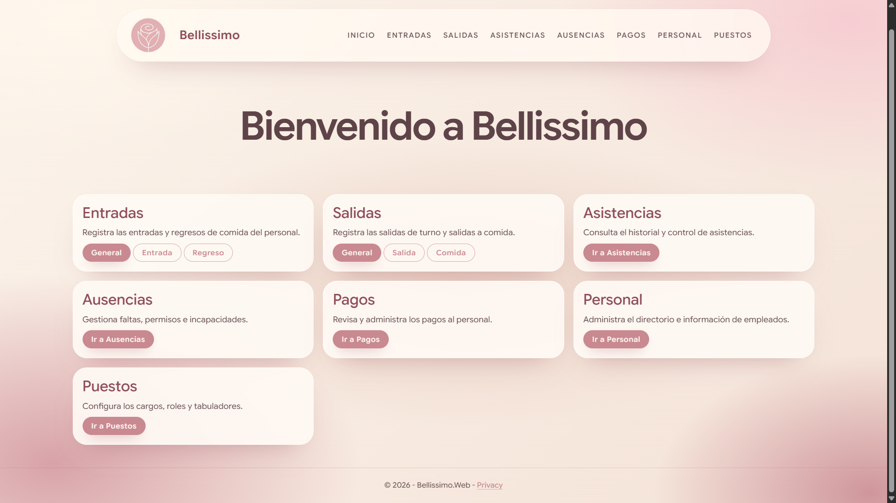

2. **Catálogo de Puestos (`Pages/Puestos/`):** Consulta, alta y edición de puestos laborales con su sueldo semanal base.
   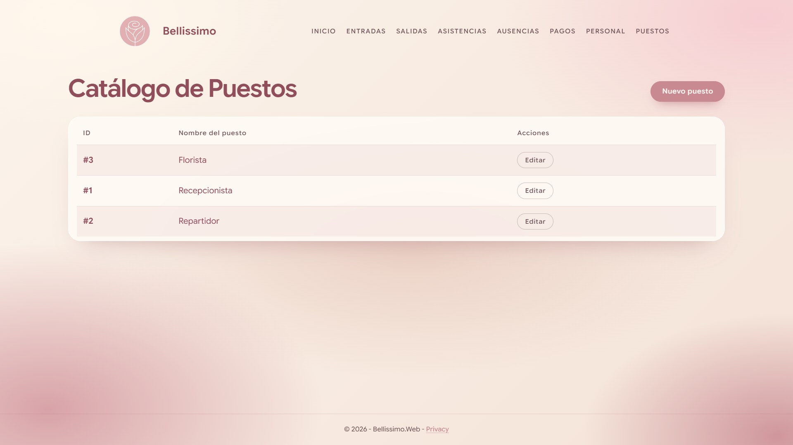

3. **Gestión de Personal (`Pages/Personal/`):** Listado con filtro de búsqueda por nombre/clave, alta vinculada a puesto y edición con baja lógica.
   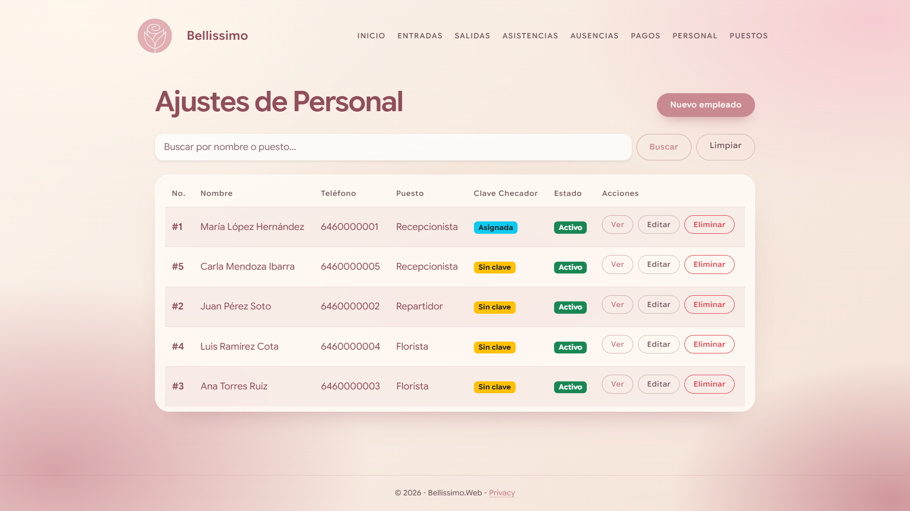
   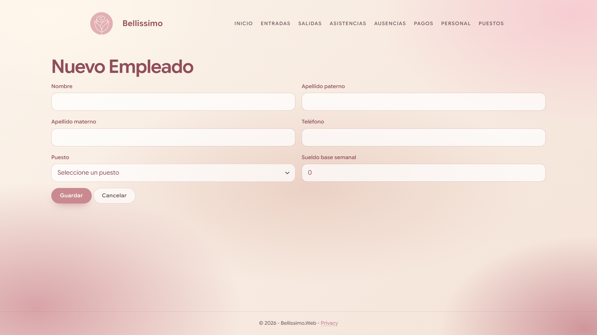

4. **Gestión de Ausencias (`Pages/Ausencias/`):** Registro, edición y eliminación de faltas justificadas, injustificadas o vacaciones.
   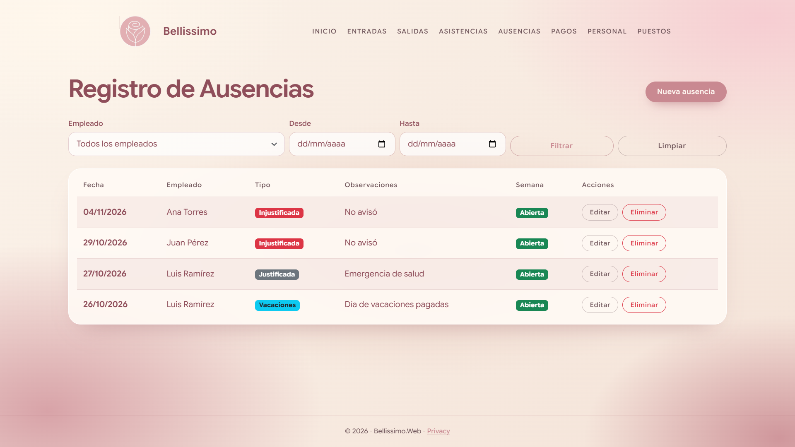

5. **Checador de Entradas y Salidas (`Pages/RegistroEntradas/` y `RegistroSalidas/`):** Terminal rápida donde el empleado ingresa su clave personal para registrar sus marcas del día.
   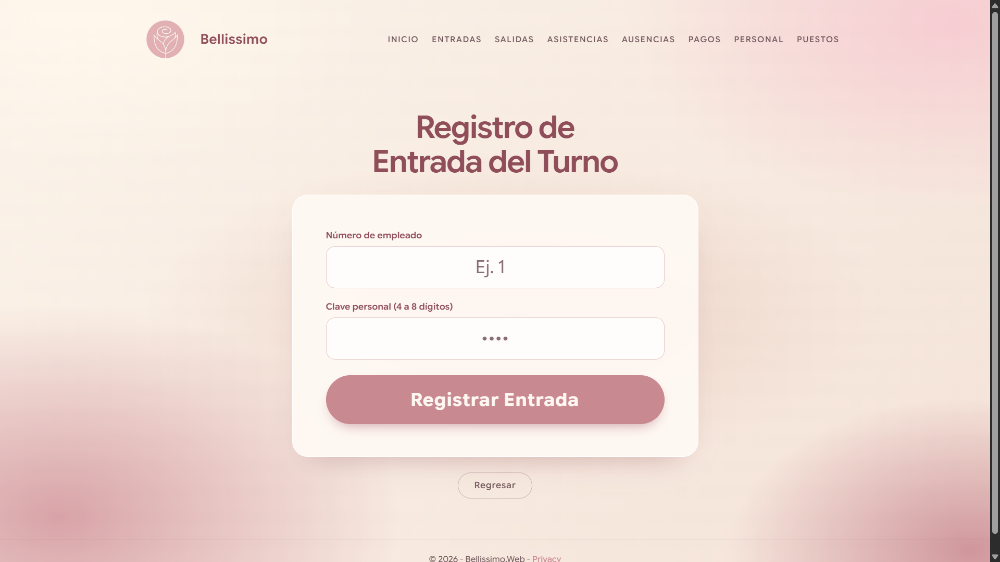

6. **Nómina Semanal y Ticket de Pago (`Pages/Pagos/`):** Cálculo automático de pagos por semana y visualización del recibo individual desglosado con opción de observaciones y cierre.
   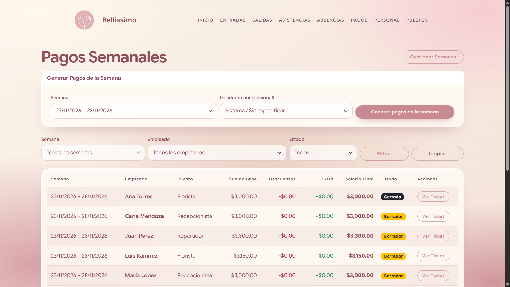
   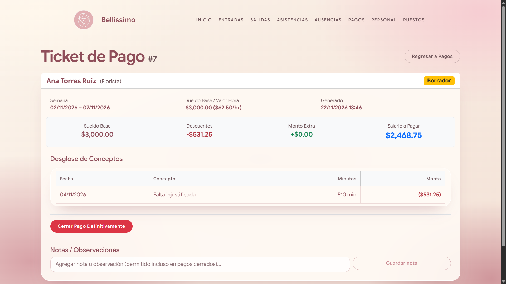

7. **Reporte de Asistencias (`Pages/Asistencias/`):** Consulta filtrada por fechas/empleado, corrección manual de horarios y manejo de estados vacíos.
   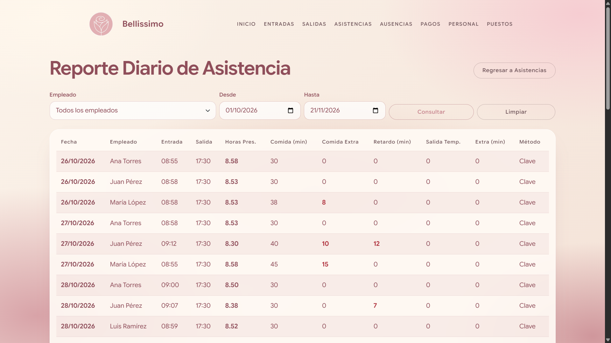
   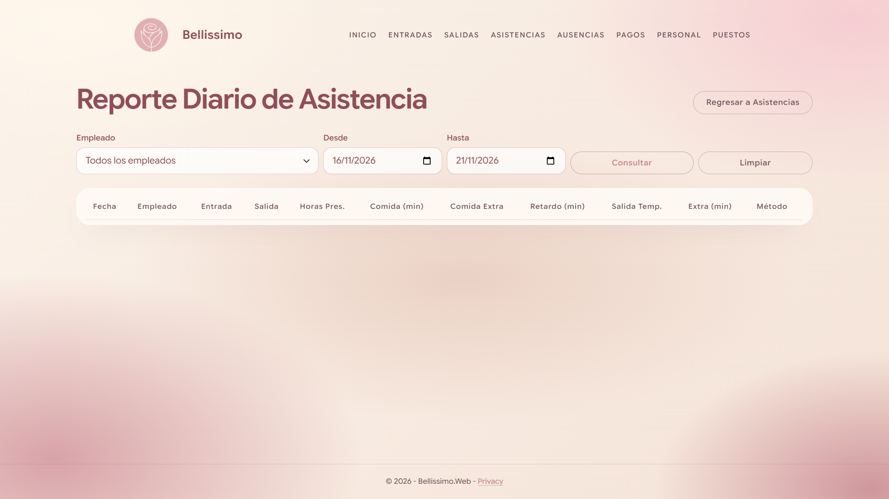

---

# 5. Resumen general de la base de datos

La aplicación se conecta a **MySQL 8.0** (base `belissimo`) para garantizar persistencia real e integridad referencial:
* **Estructura:** 11 tablas normalizadas (`puesto`, `empleado`, `usuario`, `horario_general`, `configuracion`, `registro_asistencia`, `ausencia`, `semana`, `pago_semanal`, `detalle_pago` y `auditoria_registro`).
* **Integración y seguridad:** La capa `Bellissimo.Datos` consume procedimientos almacenados (`sp_registrar_checada`, `sp_generar_pago`, `sp_ticket`, `sp_cerrar_pago`) mediante **ADO.NET** con consultas parametrizadas, utilizando un usuario de mínimo privilegio (`app_floreria`) cuya cadena de conexión se protege con **.NET User Secrets**.
* **Auditoría y congelamiento:** Al cerrar un pago desde la web, MySQL bloquea ediciones en esa semana para conservar el historial exacto del ticket y audita cualquier corrección de horario.

---

# 6. Validaciones visuales y pruebas de funcionalidad

* **Validaciones en dos niveles:** Los formularios validan campos obligatorios, formatos y rangos numéricos en pantalla; si ocurre un error de regla de negocio en el servidor (clave inexistente, registro duplicado o semana cerrada), la capa `Negocios` lo traduce a una alerta amigable en español (`alert-danger`).
  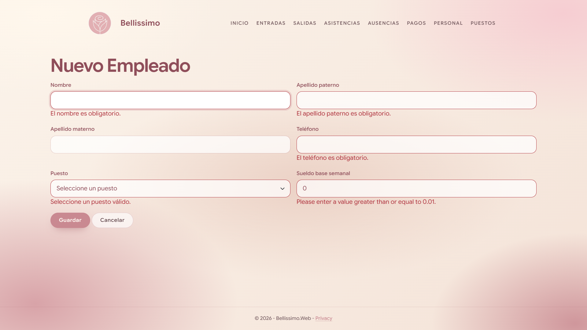
  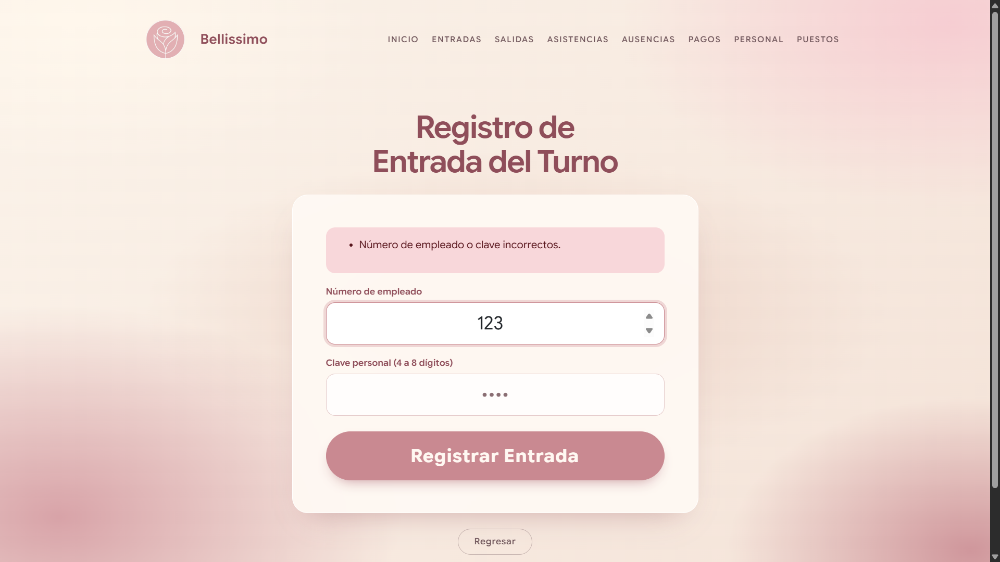

* **Persistencia verificada:** Se realizaron registros desde la interfaz web, se verificaron mediante `SELECT` en **MySQL Workbench** y se reinició por completo la aplicación (`dotnet run`), comprobando que toda la información permanece almacenada.
  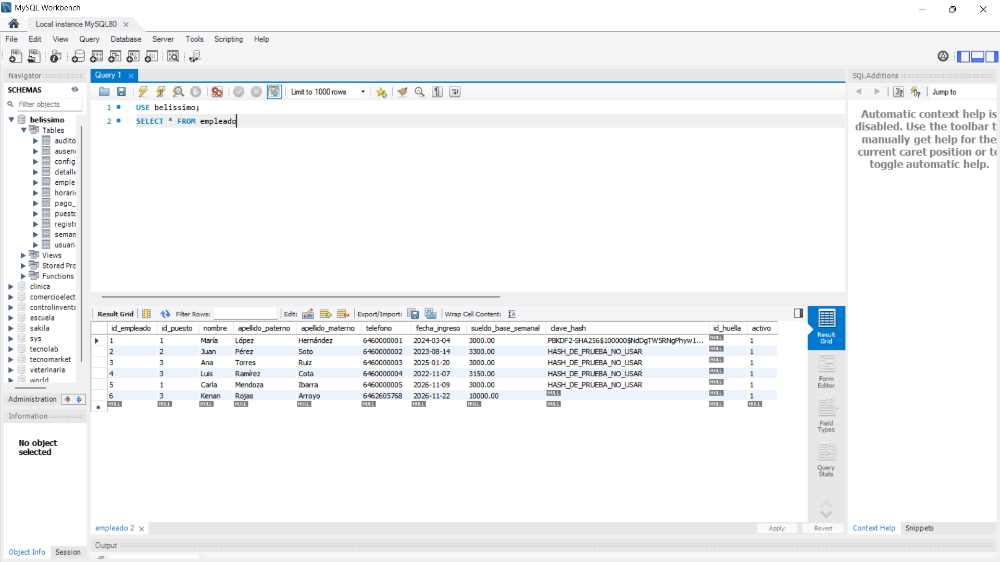
  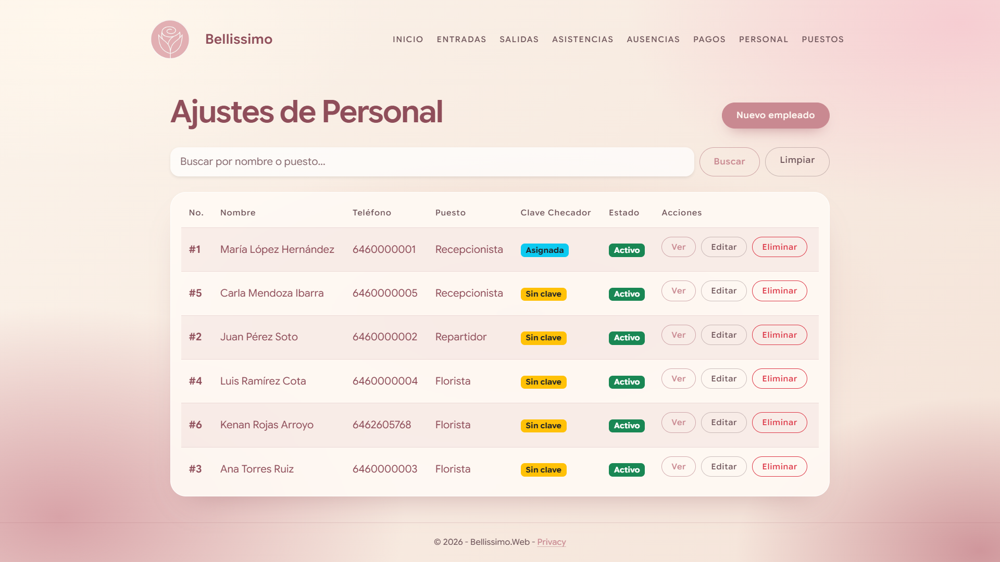

| ID | Prueba realizada | Módulo | Resultado | Estado |
| --- | --- | --- | --- | :---: |
| **P01** | Alta, búsqueda, edición y baja lógica de personal | `/Personal` | Filtra correctamente, muestra estado vacío si no hay coincidencias y guarda cambios. | **Aprobado** |
| **P02** | Validación de formularios y errores de negocio | `/Personal` y `/Checador` | Bloquea campos vacíos y muestra alertas claras ante claves inválidas o duplicadas. | **Aprobado** |
| **P03** | Registro de checadas con clave personal | `/RegistroEntradas` | Registra la marca correspondiente con hora exacta y confirma al usuario. | **Aprobado** |
| **P04** | CRUD de puestos y ausencias | `/Puestos` y `/Ausencias` | Crea, edita y elimina registros vinculando correctamente empleado y puesto. | **Aprobado** |
| **P05** | Generación de nómina, ticket y cierre semanal | `/Pagos` | Calcula sueldos/descuentos, muestra desglose en ticket y bloquea cambios al cerrar. | **Aprobado** |
| **P06** | Persistencia real tras reiniciar la aplicación | General / MySQL | Los datos sobreviven al cierre del servidor y coinciden con MySQL Workbench. | **Aprobado** |

---

# 7. Conclusiones

* **Conclusión general:** El desarrollo de **Bellissimo** permitió integrar **ASP.NET Core Razor Pages** bajo una arquitectura en **4 capas**, logrando una interfaz visual limpia, responsiva y fácil de operar que garantiza la consistencia y persistencia real de los datos de la florería en MySQL.
* **Kenan Rojas Arroyo (Frontend):** Implementé las vistas Razor, formularios con *Tag Helpers*, validaciones visuales, manejo de estados vacíos y el diseño responsivo en Bootstrap para cada módulo del sistema.
* **Troy Leonardo Moreno Calderon (Backend):** Diseñé la arquitectura en 4 capas en C#, la lógica de negocio, la traducción controlada de excepciones y la integración de código del equipo en GitHub.
* **Jose Antonio Montoya Garcia (DBA):** Estructuré la base de datos relacional en MySQL 8.0, los procedimientos almacenados para checadas y nómina, y validé la persistencia e integridad de los datos.

---

# 8. Referencias

* Microsoft. (2026). *Introducción a Razor Pages en ASP.NET Core*. Microsoft Learn. https://learn.microsoft.com/es-es/aspnet/core/razor-pages/
* Microsoft. (2026). *Tag Helpers en formularios en ASP.NET Core*. Microsoft Learn. https://learn.microsoft.com/es-es/aspnet/core/mvc/views/working-with-forms
* Bootstrap Team. (2025). *Bootstrap 5.3 Documentation*. https://getbootstrap.com/docs/5.3/
* Oracle. (2026). *MySQL Connector/NET Developer Guide (ADO.NET)*. https://dev.mysql.com/doc/connector-net/en/